# Установка программы и подключение к сайту: пошаговая инструкция

Инструкция для того, кто ставит программу впервые. Она проводит от чистого компьютера с Windows до работающего турнира: программа в зале, пароль и лицензия, сеть Wi-Fi, табло, результаты и онлайн-заявки на сайте ffk52.ru, судейские планшеты, экран диктора.

Эта же инструкция лежит в папке программы файлом `Инструкция по установке.pdf`.

## Содержание

1. [Что понадобится](#1-что-понадобится)
2. [Установка Docker Desktop](#2-установка-docker-desktop)
3. [Скачивание программы](#3-скачивание-программы)
4. [Подготовка сайта: два разных архива](#4-подготовка-сайта-два-разных-архива)
5. [Ретранслятор на хостинге (ag-relay-php.zip)](#5-ретранслятор-на-хостинге-ag-relay-phpzip)
6. [Плагин WordPress (ag-results-wordpress.zip)](#6-плагин-wordpress-ag-results-wordpresszip)
7. [Первый запуск программы](#7-первый-запуск-программы)
8. [Вход в секретариат, пароль и лицензия](#8-вход-в-секретариат-пароль-и-лицензия)
9. [Сеть Wi-Fi в зале](#9-сеть-wi-fi-в-зале)
10. [Новое соревнование и репетиция](#10-новое-соревнование-и-репетиция)
11. [Проверка связи с сайтом](#11-проверка-связи-с-сайтом)
12. [Табло результатов на странице сайта](#12-табло-результатов-на-странице-сайта)
13. [Онлайн-заявки и кнопка «Подать заявку»](#13-онлайн-заявки-и-кнопка-подать-заявку)
14. [Заявки в Excel и столбец «Пол»](#14-заявки-в-excel-и-столбец-пол)
15. [Судьи: QR-коды, ссылки и планшеты](#15-судьи-qr-коды-ссылки-и-планшеты)
16. [Табло в зале, таймер и экран диктора](#16-табло-в-зале-таймер-и-экран-диктора)
17. [День соревнований: готовность и страховка](#17-день-соревнований-готовность-и-страховка)
18. [Обновление программы](#18-обновление-программы)
19. [Если что-то не работает](#19-если-что-то-не-работает)

---

## 1. Что понадобится

- **Компьютер секретариата** с Windows 10 или 11 (64 бит), желательно 8 ГБ памяти или больше. На нём работает вся программа.
- **Интернет на время установки.** Первый запуск скачивает около 1 ГБ. Во время соревнований интернет нужен только для сайта: зал работает и без него.
- **Роутер Wi-Fi в зале.** Компьютер секретариата, планшеты судей и компьютер табло должны быть в одной сети, лучше отдельной для судей ([шаг 9](#9-сеть-wi-fi-в-зале)).
- **Ключ лицензии** — строка, которая начинается с `AG1.`. Её присылает владелец программы. Без ключа можно провести только пробный турнир.
- **Доступ к хостингу сайта** (панель управления, например Beget, с файловым менеджером) и **логин администратора WordPress** сайта ffk52.ru. Нужны один раз, при подключении сайта.

Порядок действий такой: ставим Docker и программу (шаги 2–3), готовим сайт (шаги 4–6), запускаем программу, вводим пароль и лицензию, настраиваем сеть (шаги 7–10) и связываем программу с сайтом (шаг 11). Сайт можно подключить и позже, это описано в [шаге 11](#если-при-первом-запуске-сайт-пропустили).

## 2. Установка Docker Desktop

Программа работает внутри Docker: он сам ставит базу данных и сервер, ничего больше устанавливать не нужно.

1. Откройте сайт [docker.com](https://www.docker.com/products/docker-desktop/) и нажмите **Download Docker Desktop → Download for Windows – AMD64**.
2. Запустите скачанный `Docker Desktop Installer.exe`. В окне настроек оставьте галочку **Use WSL 2 instead of Hyper-V** и нажмите **OK**.
3. Когда установка закончится, нажмите **Close and restart**: компьютер перезагрузится.
4. После перезагрузки Docker Desktop откроется сам. Примите соглашение (**Accept**). Входить в учётную запись Docker не обязательно: нажмите **Skip** или **Continue without signing in**, если такие кнопки есть.
5. Если Docker попросит обновить WSL, согласитесь (или выполните в окне PowerShell команду `wsl --update`) и перезагрузите компьютер ещё раз.
6. Дождитесь, пока внизу окна Docker Desktop появится зелёная надпись **Engine running**. Окно Docker можно закрыть: программа сама запускает Docker, когда он нужен.

> Если Docker пишет про виртуализацию (Virtualization, Hyper-V, BIOS), включите виртуализацию в BIOS компьютера (пункт Intel VT-x, AMD-V или SVM). Это разовая настройка.

## 3. Скачивание программы

1. Откройте страницу программы: <https://github.com/Grechihin-Aleksey/Artistic_gymnastics>.
2. Нажмите зелёную кнопку **Code** → **Download ZIP**.
3. Откройте скачанный архив и нажмите **Извлечь все**. Укажите папку `C:\` и нажмите **Извлечь**.
4. В `C:\` появится папка `Artistic_gymnastics-main`. Переименуйте её в `gymnastics`.

Должна получиться папка `C:\gymnastics`, а в ней файлы `Запуск.bat`, `Обновить.bat`, `Инструкция по установке.pdf` и папки `apps`, `docs`, `downloads`, `scripts`.

> Не кладите программу на Рабочий стол и в папки OneDrive: OneDrive может синхронизировать резервные копии базы и мешать работе. Папка `C:\gymnastics` — самый надёжный вариант, и дальше в инструкции используется именно она.

В папке `C:\gymnastics\downloads` лежат два архива для сайта. Они понадобятся в следующих шагах.

## 4. Подготовка сайта: два разных архива

Сайт получает результаты из зала через **ретранслятор** — небольшую программу на PHP, которая лежит на хостинге рядом с сайтом. Зрители сайта обращаются только к ретранслятору, поэтому нагрузка на интернет в зале не растёт, сколько бы людей ни смотрело результаты.

В папке `downloads` два архива, и их **нельзя путать**:

| Архив | Что это | Куда ставить | Как |
| --- | --- | --- | --- |
| `ag-relay-php.zip` | Ретранслятор (папка `results`). **Это не плагин.** | Хостинг, папка `public_html` сайта | Файловый менеджер хостинга, [шаг 5](#5-ретранслятор-на-хостинге-ag-relay-phpzip) |
| `ag-results-wordpress.zip` | Плагин WordPress «Табло результатов»: шорткоды табло и кнопки «Подать заявку» | Админка WordPress | «Плагины → Загрузить плагин», [шаг 6](#6-плагин-wordpress-ag-results-wordpresszip) |

Если загрузить `ag-relay-php.zip` через «Плагины → Загрузить плагин», WordPress выдаст ошибку: в этом архиве нет плагина. Если распаковать плагин в `public_html`, шорткоды не заработают. Каждый архив — строго в своё место.

### Придумайте токен ретранслятора

Токен — это пароль, с которым программа в зале отправляет результаты на сайт. Посторонний без токена не сможет подменить результаты.

- Не короче 16 символов, только латинские буквы и цифры, без пробелов. Например, наберите 24 случайных символа вроде `k7Rm2QxP9vLt4WcZ8nYb3HsD` (этот пример не используйте, придумайте свой).
- Запишите токен: он нужен ровно в двух местах — в файле `config.php` на хостинге (шаг 5) и в программе в зале (шаг 7).
- Это **не** токен секретариата. Токен секретариата программа создаст сама при первом запуске.

## 5. Ретранслятор на хостинге (ag-relay-php.zip)

Пример для Beget, на других хостингах пункты называются похоже.

1. Войдите в панель управления хостингом и откройте **Файловый менеджер**.
2. Откройте папку сайта, а в ней папку **`public_html`** (на Beget путь выглядит как `ffk52.ru/public_html`). В ней лежат файлы WordPress: `wp-config.php`, папки `wp-admin`, `wp-content`.
3. Загрузите в эту папку файл `C:\gymnastics\downloads\ag-relay-php.zip` (кнопка «Загрузить файлы»).
4. Распакуйте архив прямо здесь: правой кнопкой по `ag-relay-php.zip` → **Распаковать** (или «Извлечь»). Появится папка `results`.
5. Проверьте, что получилось `public_html/results/index.php`, а не `public_html/results/results/…`. Архив `ag-relay-php.zip` после распаковки можно удалить.
6. Откройте файл `public_html/results/config.php` на редактирование. В строке

   ```php
   $RELAY_TOKEN = 'ВСТАВЬТЕ-СЮДА-ТОКЕН';
   ```

   замените `ВСТАВЬТЕ-СЮДА-ТОКЕН` на свой токен. Одинарные кавычки и точку с запятой оставьте:

   ```php
   $RELAY_TOKEN = 'ваш-токен-из-шага-4';
   ```

   Сохраните файл.

**Проверка.** Откройте в браузере:

- `https://ffk52.ru/results/health` — должно показать `{"ok":true}`. Если «страница не найдена», ретранслятор лежит не в той папке (см. пункт 5).
- `https://ffk52.ru/results/api/competitions` — должно показать `[]` (пустой список: турниров ещё нет). Если видите «Ретранслятор не настроен: впишите токен в config.php», токен в `config.php` не сохранился или короче 16 символов.

> **Важно: папку `results/data` никогда не удаляйте и не перезаписывайте.** В ней хранятся результаты турниров, присланные онлайн-заявки и выложенные протоколы. Папку `results` целиком тоже не удаляйте.

### Обновление ретранслятора

Когда в программе выходит новая версия ретранслятора (новый `downloads/ag-relay-php.zip` после «Обновить.bat»):

1. Откройте `public_html/results/config.php` и скопируйте свой токен в Блокнот.
2. Загрузите новый `ag-relay-php.zip` в `public_html` и распакуйте **с заменой файлов**. Ничего не удаляйте заранее: в архиве нет ваших данных, папка `results/data` останется как была.
3. В архиве лежит чистый `config.php`, поэтому токен затрётся заглушкой. Снова откройте `results/config.php`, вставьте свой токен и сохраните.
4. Проверьте `https://ffk52.ru/results/api/competitions`: должен открыться список турниров, а не сообщение «Ретранслятор не настроен».

## 6. Плагин WordPress (ag-results-wordpress.zip)

Плагин нужен, чтобы табло и кнопку «Подать заявку» мог вставить на страницу любой редактор сайта простым шорткодом. Ставит его один раз администратор сайта.

1. Войдите в админку сайта: `https://ffk52.ru/wp-admin`.
2. Слева откройте **Плагины → Добавить новый** (в новых версиях WordPress — «Добавить плагин»).
3. Вверху нажмите **Загрузить плагин** → **Выберите файл** → укажите `C:\gymnastics\downloads\ag-results-wordpress.zip` → **Установить**.
4. Нажмите **Активировать плагин**. В списке плагинов появится «Табло результатов (спортивная гимнастика)».
5. Откройте **Настройки → Табло результатов**. Если ретранслятор лежит в `public_html/results` этого же сайта (как в шаге 5), поле «Адрес ретранслятора» оставьте **пустым**: плагин сам возьмёт `https://ffk52.ru/results`. Адрес вписывают, только если ретранслятор стоит на другом сайте.

**Обновление плагина.** Загрузите новый архив тем же способом. WordPress предложит **Заменить текущую версию загруженной**, согласитесь. Кнопке «Подать заявку» нужен плагин версии 1.3 или новее: версию видно в списке плагинов.

## 7. Первый запуск программы

1. Откройте папку `C:\gymnastics`.
2. Нажмите правой кнопкой по **`Запуск.bat`** → **Запуск от имени администратора**. Права администратора нужны только в первый раз: программа откроет в брандмауэре Windows порт 3000, чтобы планшеты судей могли подключиться. Дальше запускайте обычным двойным щелчком.
3. Если Windows покажет синее окно «Система Windows защитила ваш компьютер», нажмите **Подробнее → Выполнить в любом случае**.
4. Программа создаст файл настроек `.env` с токеном секретариата и задаст два вопроса:
   - **«Адрес ретранслятора на сайте»** — введите `https://ffk52.ru/results` и нажмите Enter. Если сайт пока не готов, просто нажмите Enter: сайт подключите позже ([шаг 11](#если-при-первом-запуске-сайт-пропустили)).
   - **«Токен ретранслятора»** — вставьте токен из шага 4, тот же, что в `config.php`, и нажмите Enter.
5. Программа сама запустит Docker Desktop, если он закрыт, и соберёт сервер. **Первый раз это занимает 5–15 минут**, в окне бегут строки сборки. Окно не закрывайте.
6. Когда всё готово, в окне появится:

   ```
   Сервер работает.
     Секретариат: http://192.168.1.10:3000/judge/#/admin
     Табло:       http://192.168.1.10:3000/board/
     Токен секретариата: ...
   ```

   Цифры адреса у вас будут свои. Браузер сам откроет страницу секретариата.

Запишите адрес секретариата, адрес табло и токен секретариата. Токен — запасной ключ секретариата: им входят в первый раз и если пароль забыт. Токен всегда можно посмотреть в файле `C:\gymnastics\.env`, строка `ADMIN_TOKEN=`.

**В следующие разы** (например, в день соревнований) просто дважды щёлкните `Запуск.bat`: он быстро поднимет программу, покажет адреса и откроет секретариат. Турниры при перезапуске и выключении компьютера сохраняются.

## 8. Вход в секретариат, пароль и лицензия

1. В браузере открыта страница `http://192.168…:3000/judge/#/admin`. **Открывайте секретариат именно по такому адресу** (с цифрами сети), а не `localhost`: этот адрес попадает в QR-коды судей, и с `localhost` планшеты не подключатся.
2. **Первый вход — токеном.** В поле **«Пароль секретариата»** вставьте токен из окна запуска и нажмите **«Войти»**.

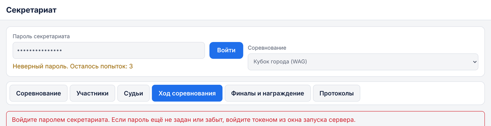

3. **Сразу задайте свой пароль.** Откройте **«Пароль и вход»**, два раза впишите новый пароль (не короче 8 символов) и нажмите **«Задать пароль»**. Дальше входите этим паролем. Токен храните как запасной ключ: им можно войти, даже если пароль забыт или вход заблокирован.

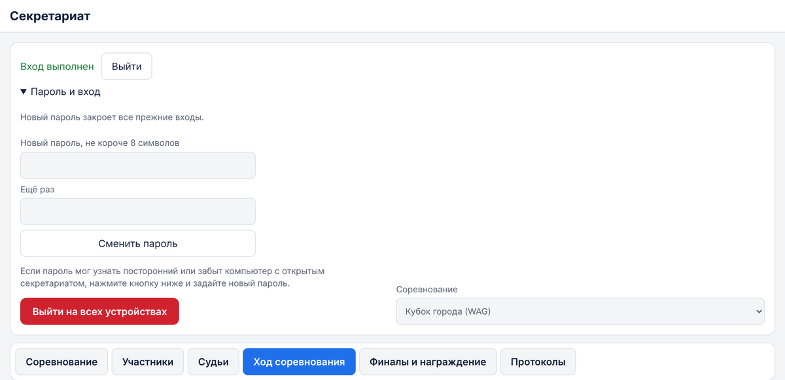

   Что важно знать о входе:
   - вход помнится, пока открыта вкладка, и сам закрывается через 7 дней;
   - после 5 неверных паролей вход паролем с этого устройства закрывается на 15 минут, а токеном войти можно всегда;
   - если пароль мог узнать посторонний или вы оставили секретариат открытым на чужом компьютере, нажмите **«Выйти на всех устройствах»** и задайте новый пароль.

4. **Лицензия.** На экране **Соревнование** найдите блок **«Лицензия»**. Вставьте в поле **«Ключ лицензии»** ключ, который вам прислали (одна длинная строка, начинается с `AG1.`), и нажмите **«Сохранить ключ»**. Блок покажет, кому выдана лицензия и до какого дня она действует.

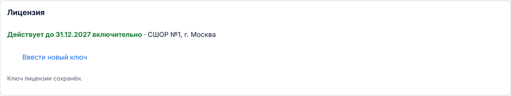

   - Пока ключ не введён, блок пишет «Лицензия не введена», и можно провести только **пробный турнир для репетиции**. Настоящее соревнование не создастся и не загрузится из файла.
   - За 30 дней до конца срока надпись становится жёлтой и показывает, сколько дней осталось.
   - Когда срок закончился, новые соревнования создать нельзя, но **уже начатые турниры работают до конца**: оценки, протоколы и сайт срок лицензии не останавливает.
   - **Продление:** попросите у владельца программы новый ключ, нажмите **«Ввести новый ключ»** и вставьте его вместо старого.

Вверху секретариата шесть экранов: **Соревнование, Участники, Судьи, Ход соревнования, Финалы и награждение, Протоколы**. Открытый экран запоминается и остаётся после обновления страницы.

## 9. Сеть Wi-Fi в зале

Компьютер секретариата, планшеты судей, компьютер табло и телефон диктора работают **в одной сети Wi-Fi**. Интернет им не нужен: всё работает внутри зала. Интернет нужен только компьютеру секретариата, чтобы отправлять результаты на сайт и забирать онлайн-заявки.

Главная защита от посторонних — отдельная сеть только для секретариата и судей:

1. Возьмите свой роутер или включите на роутере зала вторую сеть. Назовите её, например, `Судьи-гимнастика`, поставьте защиту **WPA2** или **WPA3** и пароль не короче 12 символов. Пароль сообщайте только судьям и секретариату.
2. Зрителям, тренерам и родителям дайте другую, **гостевую** сеть. На большинстве роутеров она включается в разделе «Гостевая сеть» с галочкой «Изоляция клиентов» или «Запретить доступ к локальной сети»: из гостевой сети компьютер секретариата не виден.
3. Компьютер секретариата, планшеты судей и компьютер табло подключите к сети судей. Табло на телевизоре зала можно подключить к роутеру и кабелем.
4. VPN на компьютере секретариата на время соревнований выключите: с ним программа может показать адрес, который планшетам не виден.
5. После соревнований смените пароль сети судей, если планшеты были чужие.

> Если адрес компьютера секретариата поменялся в той же сети (например, роутер выдал другой после перезагрузки), открытые страницы судей примерно через 40 секунд без связи сами найдут сервер по новому адресу и перейдут на него. В другой сети Wi-Fi планшеты сервер не найдут, поэтому подключайте компьютер к сети зала **до** печати QR-кодов и в день соревнований — к той же сети.
>
> Надёжнее всего закрепить адрес компьютера в роутере: в настройках роутера найдите раздел «DHCP» → «Резервирование адресов» (или «Привязка IP к MAC»), выберите компьютер секретариата в списке и сохраните. Тогда адрес не поменяется никогда.

## 10. Новое соревнование и репетиция

1. На экране **Соревнование** откройте **«Новое соревнование»**: впишите название и выберите программу:
   - **Женская (4 снаряда)**;
   - **Мужская (6 снарядов)**;
   - **Женская и мужская (4 и 6)** — турнир, где выступают и девочки, и мальчики. В списке это одна строка, а над экранами появится переключатель **«Девочки | Мальчики»**.
2. Выберите правила судейства (FIG или свои), при необходимости поправьте состав команды и нажмите **«Создать»**.
3. В блоке **«Правила судейства»** проверьте, как засчитываются два опорных прыжка, и при необходимости поправьте **допуски расхождения сбавок судей E**: при большем расхождении старший судья увидит предупреждение перед «Утвердить». Таблица по умолчанию — ориентир программы; если допуски заданы в положении о соревнованиях, впишите их.
4. В блоке **«Главная судейская коллегия»** впишите главного судью и главного секретаря: они печатаются в подписях под протоколами.

**Следующий турнир — по образцу прошлого.** Когда один турнир уже проведён, следующий удобнее создать блоком **«Новое соревнование по образцу прошлого»**: выберите образец, впишите название и нажмите **«Создать по образцу»**. Перейдут правила судейства и допуски, разряды с базами и нормативами, судьи, логотип, главный судья и секретарь, общекомандный зачёт и настройки финалов; турнир из двух частей копируется обеими частями. Участники, смены, оценки и заявки не переносятся. Судьи получают новые коды: распечатайте им новые QR-коды на экране **Судьи**, старые остаются у прошлого турнира.

**Репетиция.** На том же экране есть **«Пробный турнир для репетиции»** → **«Создать пробный турнир»**. Появится турнир с 8 участниками, судьями и готовыми QR-кодами. Отсканируйте коды планшетами, пройдите одну ротацию, проверьте табло и печать протоколов. Пробный турнир не уходит на сайт, работает и без лицензии и удаляется одной кнопкой **«Удалить пробный турнир»**.

Подробно о подготовке и дне соревнований (участники, смены, жеребьёвка, ротации, финалы) — в памятке [competition-day.md](competition-day.md).

## 11. Проверка связи с сайтом

1. В шапке секретариата, справа от слова «Секретариат», есть значок **«Сайт»**. Зелёная точка — результаты доходят до сайта. Красная и надпись «Сайт: нет связи» — не доходят; наведите мышь, чтобы увидеть причину.
2. На экране **Соревнование** есть панель **«Результаты на сайте»**. Нажмите **«Отправить на сайт сейчас»**. Должна появиться надпись **«Турнир на сайте»** с временем отправки, а ссылка **«Открыть табло на сайте»** откроет табло этого турнира на ffk52.ru.


Дальше программа отправляет результаты сама: после каждого вызова участника и каждой утверждённой оценки. Если интернет в зале пропал, программа копит изменения и отправит их, когда связь вернётся.

Возможные ошибки в панели:

| Сообщение | Что сделать |
| --- | --- |
| «нет связи с сайтом: проверьте интернет и адрес RELAY_URL» | Проверьте интернет на компьютере и адрес в `.env`: `RELAY_URL=https://ffk52.ru/results` |
| «по адресу RELAY_URL нет ретранслятора: проверьте адрес» | Адрес неверный или ретранслятор лежит не в `public_html/results` (шаг 5) |
| «сайт не принял токен: RELAY_TOKEN в .env не совпадает с токеном в config.php» | Токен в `.env` (`RELAY_TOKEN`) и в `config.php` должен совпадать до символа |
| «на сайте не вписан токен в config.php» | Впишите токен в `public_html/results/config.php` (шаг 5). Так бывает и после обновления ретранслятора |

### Если при первом запуске сайт пропустили

Если панель пишет «Сайт не подключён», впишите адрес и токен вручную:

1. Откройте папку `C:\gymnastics`, нажмите правой кнопкой по файлу **`.env`** → **Открыть с помощью → Блокнот**.
2. Заполните две строки (без пробелов вокруг `=`):

   ```
   RELAY_URL=https://ffk52.ru/results
   RELAY_TOKEN=ваш-токен-из-шага-4
   ```

3. Сохраните файл (Ctrl+S) и снова запустите **`Запуск.bat`**: программа перезапустится уже с сайтом.

Остальные строки `.env` не трогайте. Особенно `ADMIN_TOKEN`: это токен секретариата.

## 12. Табло результатов на странице сайта

1. В секретариате, экран **Соревнование**, панель **«Результаты на сайте»**, нажмите **«Скопировать шорткод»**. Шорткод выглядит так:

   ```
   [ag_results id="294287a9-4c28-47c4-839a-a20e03118f07" theme="dark"]
   ```

   У турнира «Женская и мужская» в шорткоде сразу две части через запятую: на сайте над табло будет переключатель «Девочки | Мальчики».
2. В WordPress откройте нужную страницу (или создайте новую: «Страницы → Добавить»).
3. Добавьте блок **«Шорткод»** (кнопка «+» → найдите «Шорткод») и вставьте в него скопированное. В Elementor — виджет **«Шорткод»**. Шорткод можно вставить и прямо в текст.
4. Нажмите **Обновить** (или «Опубликовать») и откройте страницу: появится табло.


Турнир появляется на сайте после первого вызова участника или после кнопки «Отправить на сайт сейчас». До этого на месте табло пусто. Пробный турнир на сайт не уходит.

Шорткод можно настроить:

| Что добавить в шорткод | Что получится |
| --- | --- |
| `theme="light"` или `theme="dark"` | Светлое или тёмное табло под оформление страницы |
| `view="auto"` | Экраны по очереди (по умолчанию) |
| `view="now"` | Кто сейчас выступает на снарядах |
| `view="aa"` | Многоборье |
| `view="teams"` | Командное первенство |
| `view="VT"`, `"UB"`, `"BB"`, `"FX"` (у мужчин `"FX"`, `"PH"`, `"SR"`, `"VT"`, `"PB"`, `"HB"`) | Отдельный снаряд |
| `category="2"` | Только второй разряд (разряды нумеруются с 1, в том порядке, как в турнире) |

Например: `[ag_results id="…" view="aa" theme="light"]`.

**Протоколы на сайте.** После соревнований на экране **Протоколы** в панели **«Протоколы на сайте»** нажмите **«Выложить на сайт»**: протоколы в PDF и итоги в Excel появятся на сайте, ссылка «Открыть на сайте» ведёт к ним. После правок нажмите «Обновить на сайте».

## 13. Онлайн-заявки и кнопка «Подать заявку»

Онлайн-заявки работают, только когда программа подключена к сайту (шаг 11). Клубы заполняют заявку на сайте, а она попадает в секретариат.

### Открыть приём

1. В секретариате выберите турнир и откройте экран **Участники**, панель **«Онлайн-заявки клубов»**.
2. При желании укажите срок в поле **«Принимать до»** и нажмите **«Открыть приём»**.
3. Появится ссылка для клубов. **Ссылка одна на весь турнир**: её можно разослать всем клубам и выложить на сайт. При повторном открытии приёма ссылка не меняется. По ссылке можно подать заявку, но нельзя увидеть чужие.

У турнира «Женская и мужская» ссылка тоже одна на обе части: в форме у каждого участника есть обязательное поле **«Пол»** (Ж или М), и при приёме девочки попадают в список девочек, мальчики — в список мальчиков.

### Кнопка «Подать заявку» на сайте

1. В той же панели нажмите **«Скопировать шорткод кнопки»**. Шорткод выглядит так:

   ```
   [ag_entry id="ID соревнования" key="ключ приёма"]
   ```

2. Вставьте его на страницу WordPress так же, как табло: блок **«Шорткод»** или прямо в текст. Надпись меняется атрибутом `text`: `[ag_entry id="…" key="…" text="Заявка на первенство"]`.
3. Нужен плагин «Табло результатов» версии 1.3 или новее (шаг 6). Если плагина нет, нажмите **«Скопировать HTML кнопки»** и вставьте код в блок «Произвольный HTML»: это обычная ссылка, WordPress её не вырезает.


### Что видит клуб

Клуб нажимает кнопку или открывает ссылку и заполняет клуб, город, контакт и участников. Строки можно вводить по одной или нажать **«Вставить из таблицы»** и вставить список из Excel со столбцами: Фамилия, Имя, Отчество, Дата рождения, Разряд, Тренер, Команда (у турнира девочек и мальчиков ещё **Пол**: Ж или М). После отправки клуб получает номер заявки и ссылку, по которой видит, принята ли она.

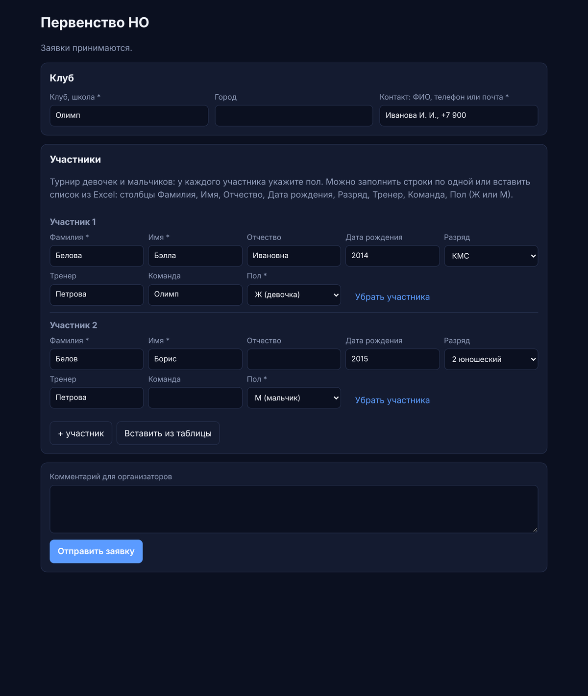

### Принять заявки

1. Пока у компьютера секретариата есть интернет, программа сама забирает заявки **каждые 5 минут**. Чтобы забрать сразу, нажмите **«Забрать заявки»**. Компьютер не обязан быть включён весь срок приёма: заявки подождут на сайте.
2. У каждой заявки видны клуб, контакт и состав. **«Принять в список»** добавляет участников в турнир. **«Отклонить»** спросит причину, и клуб увидит её по своей ссылке.
3. Когда список собран или срок вышел, нажмите **«Закрыть приём»**.

Форма защищена от спама: она открывается только по ссылке с ключом, отбрасывает заявки ботов и принимает не больше 10 заявок в час с одного адреса.

## 14. Заявки в Excel и столбец «Пол»

Заявки можно принимать и файлами Excel, без сайта.

1. Экран **Участники** → ссылка **«Бланк заявки для клубов»**: скачивается `Заявка.xlsx` с нужными столбцами. Разошлите его клубам.
2. Присланный файл загрузите кнопкой **«Загрузить заявку Excel»**. Заявки нескольких клубов можно загрузить по очереди, проверить список в поле и нажать **«Добавить из списка»**.

Столбцы узнаются по заголовкам, порядок не важен: **Фамилия, Имя** (или одним столбцом **ФИО**), **Отчество, Дата рождения, Клуб, Город, Тренер, Команда, Разряд, Смена, Стартовый номер, Пол**.

**Столбец «Пол»** нужен для турнира «Женская и мужская»: список загружается один раз и делится на девочек и мальчиков по этому столбцу. Пишите **Ж** или **М** (программа понимает и «жен», «девочки», «муж», «мальчики», «юноши»). В турнирах только девочек или только мальчиков столбец можно не заполнять.

## 15. Судьи: QR-коды, ссылки и планшеты

1. Экран **Судьи**, форма **«Судьи и QR-коды»**: впишите ФИО, категорию, выберите снаряд, роль (Старший судья, Судья D, Судья E) и место в бригаде, нажмите **«Добавить судью»**.
2. Если на снаряде **один планшет**, заведите только старшего судью и поставьте галочку **«Один планшет на снаряд»**: впишите судей бригады по одному в строке. Тогда QR-код нужен один — старшему судье.
3. Нажмите **«Показать QR-коды всех судей»** и распечатайте листок. Судья сканирует свой код камерой планшета и сразу попадает на страницу своего снаряда. Коды можно перепечатать в любой момент: они не меняются, планшеты продолжают работать.


4. Если у судьи компьютер без камеры, нажмите **«Ссылки всех судей (для компьютеров)»**: появится таблица ссылок, её можно скачать в Excel. У каждого судьи своя ссылка, она работает как пароль: отправляйте каждому только его строку.

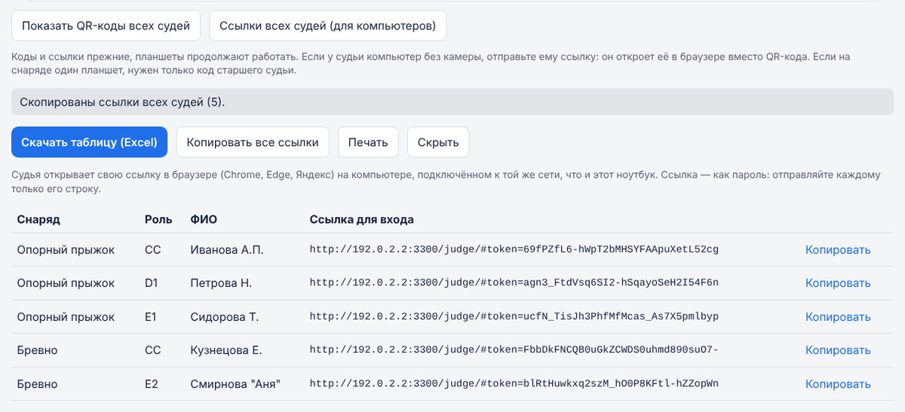

### Один код — один планшет

QR-код судьи работает **на одном планшете** — на том, где его отсканировали первым. Если судья сменил планшет (сел аккумулятор, разбился экран), новый планшет покажет «Этот QR-код уже открыт на другом планшете». В панели **«Связь судей»** (экран «Судьи») появится предупреждение и кнопка **«Разрешить новый планшет»**: нажмите её, и новый планшет войдёт сам через несколько секунд.

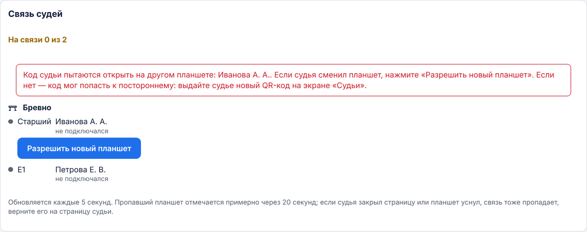

Если судья планшет не менял, код мог попасть к постороннему: нажмите у судьи **«Новый QR-код»** и выдайте новый листок. Старый код перестанет работать.

### Связь планшетов

- В панели **«Связь судей»** видно, кто из судей на связи, кто отключился и когда.
- Если планшет потерял Wi-Fi, судья видит **«Нет связи, подключаемся…»** и кнопку **«Подключиться сейчас»**. Оценки, поставленные без связи, планшет хранит и отправит сам. Когда судья вернётся в зону Wi-Fi, планшет переподключится сам и покажет **«Связь восстановлена»**.

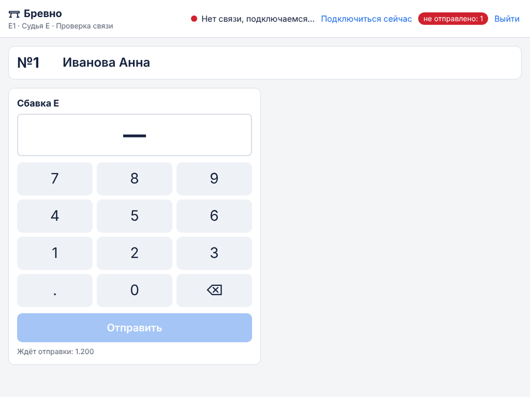

- Если планшет пишет «Код входа больше не действует», судье выдали новый QR-код: отсканируйте его.
- Страница судьи не даёт планшету гасить экран между выступлениями: после первого касания экран остаётся включённым, пока страница открыта. Если планшет всё же гаснет, судья увидит подсказку. Тогда отключите в настройках планшета автоблокировку или поставьте самый долгий тайм-аут экрана.

Если планшет не открывает страницу по QR-коду: проверьте, что секретариат открыт по адресу `http://192.168…`, а не `localhost` (иначе в кодах неверный адрес), что планшет в той же сети (шаг 9) и что `Запуск.bat` хотя бы раз запускался от имени администратора (шаг 7).

## 16. Табло в зале, таймер и экран диктора

1. На компьютере, подключённом к большому экрану или проектору (он должен быть в той же сети Wi-Fi), откройте в браузере адрес табло из окна запуска: `http://192.168…:3000/board/`. Можно открыть табло и на самом компьютере секретариата, на втором мониторе.
2. Выберите соревнование из списка.
3. Нажмите **F11**: браузер развернётся на весь экран.

Вверху табло переключатели: **Авто** (экраны по очереди), **Сейчас** (кто на снарядах), **Многоборье**, **Команды** и отдельные снаряды.

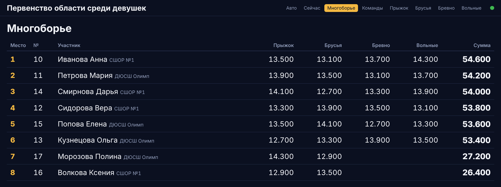

У турнира «Женская и мужская» на экране **Ход соревнования** есть панель **«Табло в зале»**: показать на табло девочек, мальчиков или чередовать их каждые 15 секунд — 2 минуты.

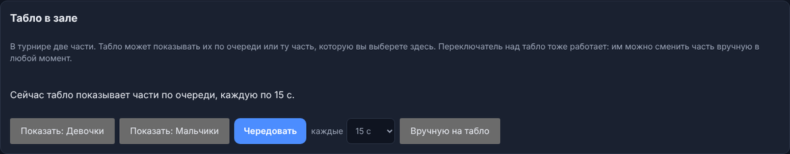

**Таймер на табло.** Для разминки, перехода на снаряды или перерыва на экране **Ход соревнования** есть блок **«Таймер на табло»**. Нажмите кнопку с готовым временем или впишите свою надпись и время (минуты:секунды) и нажмите **«Запустить»**. Табло покажет крупный обратный отсчёт над результатами; за 10 секунд до конца цифры желтеют, в конце видно «Время!», и через 5 секунд таймер пропадает. **«Убрать с табло»** снимает его раньше. На сайт таймер не уходит.

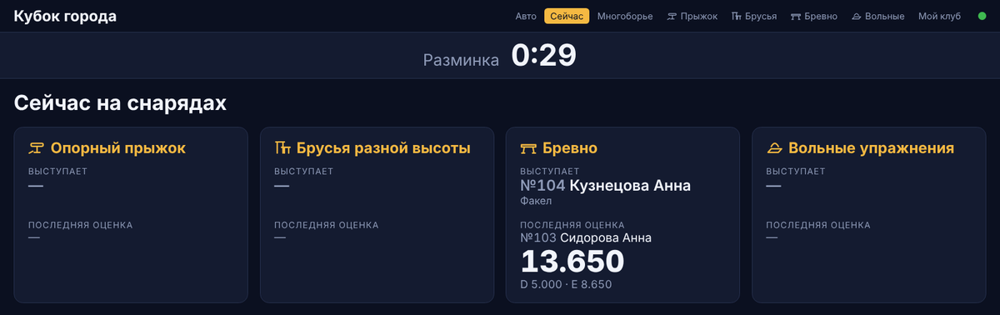

**Экран диктора.** На экране **Ход соревнования** в блоке **«Экран диктора»** скопируйте ссылку и откройте её на телефоне или ноутбуке диктора (в сети зала). По каждому снаряду там видно, кто выступает, последнюю оценку с местом на снаряде и в многоборье и кто выходит следующим. Экран обновляется сам. **Голосовой вызов.** Если ноутбук диктора подключён к колонкам зала, нажмите на экране диктора **«Включить голосовой вызов»**: программа сама объявит каждого вызванного участника («Бревно. Выступает номер 103, Сидорова Анна, клуб Олимп.») и, если отмечено «объявлять оценки», его оценку после утверждения. Говорит встроенный голос браузера, интернет не нужен. Нужен русский голос в системе: в Windows 10 и 11 он обычно есть (Параметры → Время и язык → Речь). После перезагрузки страницы голос включают снова — браузер разрешает говорить только после нажатия кнопки.

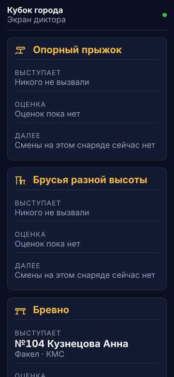

Пьедестал при награждении выводится с экрана **Финалы и награждение**, панель **«Награждение на табло»**.

## 17. День соревнований: готовность и страховка

**Готовность к старту.** Перед началом откройте экран **Ход соревнования**: вверху блок **«Готовность к старту»** одним списком показывает, всё ли готово — есть ли участники, у каждого снаряда бригада, все ли нужные планшеты на связи, подходит ли формат команд, вписана ли судейская коллегия, доходят ли результаты до сайта и свежая ли резервная копия. Зелёная галочка — всё в порядке, жёлтый знак — стоит проверить, красный крестик — без этого не начать. Список обновляется сам каждые 10 секунд.

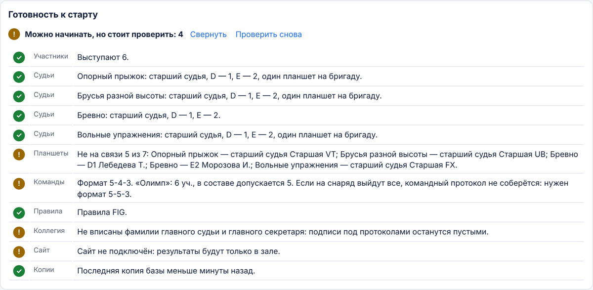

**Во время соревнований** после каждой ротации нажимайте **«Следующая ротация →»** на экране «Ход соревнования». Там же видно, кто на каждом снаряде, и таблицы по разрядам с местами.

**Работа судей.** На экране **Протоколы** кнопка **«Работа судей»** печатает для главного судьи таблицу по каждому судье E: сколько выступлений он оценил, насколько его сбавки отличались от итога бригады, строже он или мягче, сколько раз выходил за допуск и как быстро ставил оценку. Ниже — темп бригад и запросы тренеров по снарядам. Это ориентир, а не официальная аттестация.

**Резервные копии.** Программа сама снимает копию базы каждые 5 минут в папку `C:\gymnastics\backups`, а каждый турнир каждые полчаса сохраняет файлом в `C:\gymnastics\backups\tournaments`.

**Если базу пришлось восстановить** из резервной копии (`scripts\restore.ps1`), оценки последних минут могли пропасть. Включите планшеты судей, откройте на них страницы судей и на экране **Ход соревнования** в блоке **«Оценки с планшетов после восстановления»** нажмите **«Собрать оценки с планшетов»**: каждый планшет помнит утверждённые оценки своего снаряда, и пропавшие вернутся на сервер, табло и сайт. Что не вернулось, введите по судейским ведомостям.

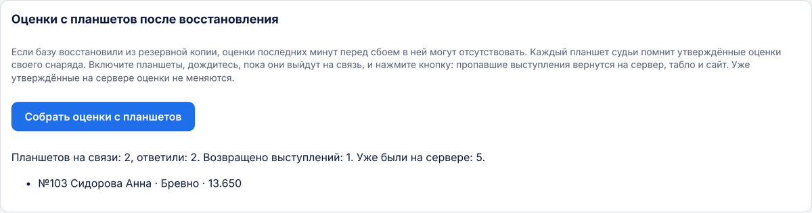

**Перенос на другой компьютер.** Кнопка **«Выгрузить в файл»** на экране «Соревнование» сохраняет турнир целиком; на новом компьютере его открывают кнопкой **«Загрузить турнир из файла»** (нужна действующая лицензия). Если у нового компьютера другой адрес в сети, выдайте судьям новые QR-коды.

## 18. Обновление программы

**Как узнать, что вышла новая версия.** Если у ноутбука сервера есть интернет, программа сама раз в 6 часов проверяет, нет ли новой версии. Когда она выходит, над вкладками секретариата появляется сообщение «Вышла новая версия программы» с коротким списком, что в ней нового. Кнопка «Скрыть до следующей версии» убирает его. Какая версия стоит сейчас, написано внизу вкладки «Соревнование», там же кнопка «Проверить сейчас». Для закрытого репозитория проверке нужен тот же ключ `GITHUB_TOKEN` в `.env`, что и для `Обновить.bat`. Без интернета проверка просто не проходит, работе это не мешает. Отключить её можно строкой `UPDATE_CHECK=off` в `.env`.

1. Закройте секретариат в браузере. Не обновляйте программу во время соревнований.
2. В папке `C:\gymnastics` дважды щёлкните **`Обновить.bat`**.
3. Программа скачает последнюю версию с GitHub, положит файлы поверх и перезапустится. **Турниры, файл `.env` (токены и адрес сайта) и резервные копии сохраняются.**
4. После обновления загляните в `C:\gymnastics\downloads`: если архивы сайта обновились, поставьте их, как в шагах 5 и 6 (ретранслятор — с сохранением токена и папки `data`, плагин — «Заменить текущую версию»). Защита заявок от спама работает только с новым ретранслятором, поэтому после этого обновления загрузите `ag-relay-php.zip` на хостинг обязательно.

## 19. Если что-то не работает

| Что случилось | Что сделать |
| --- | --- |
| Окно запуска пишет «Docker Desktop не найден» | Установите Docker Desktop (шаг 2) |
| «Docker не запустился» | Откройте Docker Desktop вручную, дождитесь «Engine running» и снова запустите `Запуск.bat` |
| «Сервер не ответил за 3 минуты» | Подождите и запустите `Запуск.bat` ещё раз. Первая сборка бывает долгой на медленном интернете |
| Секретариат просит войти | Введите пароль секретариата. Если пароль ещё не задан или забыт — токен из окна запуска или из строки `ADMIN_TOKEN=` в `C:\gymnastics\.env`, затем задайте новый пароль в «Пароль и вход» |
| «Без действующей лицензии можно проводить только пробный турнир» | Вставьте ключ лицензии в блок «Лицензия» на экране «Соревнование». Если срок закончился, попросите новый ключ у владельца программы |
| «Слишком много неверных паролей» | Подождите 15 минут или войдите токеном из окна запуска |
| Планшет судьи пишет «Этот QR-код уже открыт на другом планшете» | Экран «Судьи», панель «Связь судей» → «Разрешить новый планшет» у этого судьи |
| Планшет пишет «Нет связи, подключаемся…» | Проверьте Wi-Fi планшета. Оценки он хранит и отправит сам; можно нажать «Подключиться сейчас» |
| Планшет пишет «Код входа больше не действует» | Судье выдали новый QR-код: отсканируйте новый листок |
| Экран планшета гаснет | Коснитесь экрана после открытия страницы судьи; в настройках планшета отключите автоблокировку |
| После восстановления базы пропали последние оценки | «Ход соревнования» → «Собрать оценки с планшетов» (шаг 17) |
| Планшеты не открывают страницу | Одна сеть Wi-Fi; секретариат открыт по адресу `192.168…`; `Запуск.bat` один раз от имени администратора; VPN выключен |
| Значок «Сайт» красный | Наведите на него мышь и смотрите причину; таблица ошибок в шаге 11 |
| На странице сайта вместо табло текст «в шорткоде нет ID соревнования» | Скопируйте шорткод заново в секретариате, целиком с квадратными скобками |
| WordPress не ставит плагин | Проверьте, что загружаете `ag-results-wordpress.zip`, а не `ag-relay-php.zip` |
| Онлайн-заявки: «Сайт не подключён» | Заполните `RELAY_URL` и `RELAY_TOKEN` в `.env` (шаг 11) |

Резервные копии базы программа снимает каждые 5 минут в папку `C:\gymnastics\backups`, а каждый турнир каждые полчаса сохраняет файлом в `C:\gymnastics\backups\tournaments`. Перенести турнир на другой компьютер можно кнопкой **«Выгрузить в файл»** на экране «Соревнование» и **«Загрузить турнир из файла»** на новом компьютере.
