# Работа секретаря: пошаговая инструкция для новичка

Инструкция для того, кто впервые ведёт секретариат на соревнованиях. Она идёт по порядку, как проходит турнир: от входа в программу накануне до протоколов на сайте после награждения. Все снимки сделаны в программе на тестовом турнире «Первенство города»: девочки и мальчики, 2 юношеский разряд, три клуба.

Программа уже должна быть установлена и запущена. Как её поставить, подключить к сайту и настроить Wi-Fi в зале, написано в файле `Инструкция по установке.pdf`. Короткая памятка для опытного секретаря лежит в `docs/competition-day.md`.

Эта же инструкция лежит в папке программы файлом `Инструкция для секретаря.pdf`.

## Содержание

1. [Несколько слов, которые встретятся](#1-несколько-слов-которые-встретятся)
2. [Вход в секретариат: пароль и лицензия](#2-вход-в-секретариат-пароль-и-лицензия)
3. [Как устроена страница секретариата](#3-как-устроена-страница-секретариата)
4. [Новое соревнование (и по образцу прошлого)](#4-новое-соревнование-и-по-образцу-прошлого)
5. [Правила, нормативы, судейская коллегия, сайт](#5-правила-нормативы-судейская-коллегия-сайт)
6. [Онлайн-заявки клубов](#6-онлайн-заявки-клубов)
7. [Заявки в Excel и столбец «Пол»](#7-заявки-в-excel-и-столбец-пол)
8. [Правка участников, неявка и снятие](#8-правка-участников-неявка-и-снятие)
9. [Смены](#9-смены)
10. [Жеребьёвка](#10-жеребьёвка)
11. [Судьи и QR-коды](#11-судьи-и-qr-коды)
12. [Планшеты судей и «Разрешить новый планшет»](#12-планшеты-судей-и-разрешить-новый-планшет)
13. [Печать перед стартом](#13-печать-перед-стартом)
14. [Готовность к старту](#14-готовность-к-старту)
15. [Табло в зале и таймер разминки](#15-табло-в-зале-и-таймер-разминки)
16. [Ход соревнования: ротации](#16-ход-соревнования-ротации)
17. [Как ставит оценки старший судья](#17-как-ставит-оценки-старший-судья)
18. [Экран диктора и «Мой клуб» для тренеров](#18-экран-диктора-и-мой-клуб-для-тренеров)
19. [Правка оценок и ввод с судейских листов](#19-правка-оценок-и-ввод-с-судейских-листов)
20. [Запросы тренеров на пересмотр D](#20-запросы-тренеров-на-пересмотр-d)
21. [Сбой: сбор оценок с планшетов](#21-сбой-сбор-оценок-с-планшетов)
22. [Финалы и награждение](#22-финалы-и-награждение)
23. [Протоколы, отчёт о работе судей и архив документов](#23-протоколы-отчёт-о-работе-судей-и-архив-документов)
24. [Результаты и протоколы на сайте](#24-результаты-и-протоколы-на-сайте)
25. [Журнал изменений](#25-журнал-изменений)
26. [Вкладка «Главный судья»](#26-вкладка-главный-судья)
27. [Запасной ноутбук](#27-запасной-ноутбук)
28. [Новая версия программы](#28-новая-версия-программы)
29. [Видеоповторы](#29-видеоповторы)
30. [После соревнований](#30-после-соревнований)
31. [Очистка после турниров: место на диске](#31-очистка-после-турниров-место-на-диске)
32. [Если что-то пошло не так](#32-если-что-то-пошло-не-так)
33. [Шпаргалка на день турнира](#33-шпаргалка-на-день-турнира)

---

## 1. Несколько слов, которые встретятся

| Слово | Что значит |
| --- | --- |
| Секретариат | Страница программы на компьютере секретаря. Отсюда управляют всем турниром. |
| Планшет снаряда | Планшет старшего судьи на снаряде. Он вызывает участника и вводит оценки бригады. |
| Бригада | Судьи одного снаряда: старший судья, судья D и судьи E. |
| Смена | Группа участников, которая вместе переходит со снаряда на снаряд. |
| Ротация | Один переход: каждая смена выступает на своём снаряде, потом все переходят на следующий. |
| Разряд | Программа участника (например, «2 юношеский»). Места считаются отдельно в каждом разряде. |
| Части турнира | В турнире девочек и мальчиков две части со своими снарядами, судьями и протоколами. Между ними переключают кнопки **Девочки** и **Мальчики** вверху страницы. |

> Почти все кнопки, которые что-то меняют насовсем (жеребьёвка, удаление, деление на смены), сначала переспрашивают. Внимательно читайте вопрос и только потом нажимайте **OK**.

## 2. Вход в секретариат: пароль и лицензия

Секретариат открывается по адресу, который показало окно **Запуск** (вида `http://192.168.…:3000/judge/#/admin`). Откройте его в браузере на компьютере секретариата.

**Первый вход.** Пароля ещё нет, поэтому в поле **Пароль секретариата** вставьте токен из окна запуска (он же в строке `ADMIN_TOKEN=` файла `.env` в папке программы) и нажмите **Войти**.

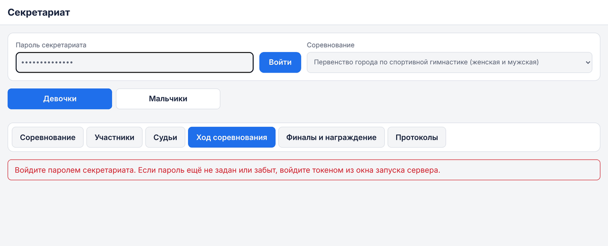

**Задайте пароль.** Нажмите **Пароль и вход**, впишите пароль не короче 8 символов два раза и нажмите **Задать пароль**. Дальше входите этим паролем, токен больше не понадобится. Пароль запишите и не оставляйте на виду.

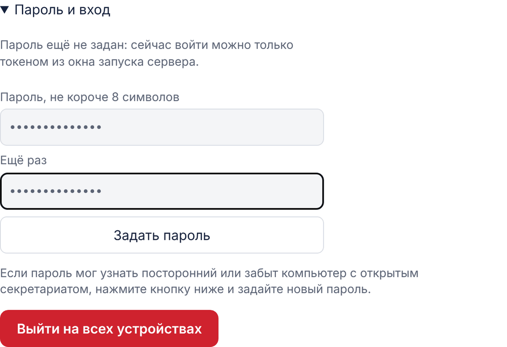

Если пароль мог узнать посторонний или вы забыли открытый секретариат на чужом компьютере, нажмите там же **Выйти на всех устройствах** и задайте новый пароль.

**Лицензия.** На экране **Соревнование** в блоке **Лицензия** вставьте ключ (строка, которая начинается с `AG1.`) и нажмите **Сохранить ключ**. Программа покажет, до какого числа действует лицензия и на кого выдана. Без лицензии можно провести только пробный турнир.

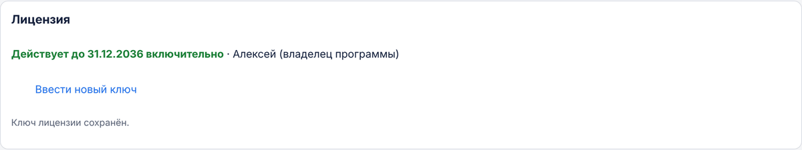

> Перед настоящим турниром полезно сделать репетицию: на экране **Соревнование** откройте **Пробный турнир для репетиции** → **Создать пробный турнир**. Появятся 8 участников, судьи и готовые QR-коды. Пробный турнир не уходит на сайт и удаляется одной кнопкой.

## 3. Как устроена страница секретариата

Вверху страницы всегда видны:

- справа — значок **Сайт**: зелёный, если результаты доходят до сайта;
- **Соревнование** — список, в котором выбирают турнир;
- кнопки **Девочки** и **Мальчики**, если в турнире две части;
- шесть экранов.

| Экран | Что на нём делают |
| --- | --- |
| Соревнование | лицензия, новое соревнование, запасной ноутбук, правила судейства, нормативы разрядов, главная судейская коллегия, отправка на сайт, перенос и удаление турнира, камеры видеоповторов, очистка после турниров, версия программы |
| Участники | онлайн-заявки, заявки Excel, ручное добавление, правка участников, смены, жеребьёвка |
| Судьи | судьи, QR-коды и их печать, код главного судьи, связь с планшетами |
| Ход соревнования | готовность к старту, табло в зале, таймер, ротации, ввод и правка оценок, экран диктора, таблицы результатов |
| Главный судья | все снаряды на одном экране и список «Что проверить» (у самого главного судьи такой же экран по своему QR-коду) |
| Финалы и награждение | финалы на снарядах, запросы тренеров, награждение на табло, общекомандный зачёт |
| Протоколы | печать перед стартом, протоколы, грамоты, протоколы на сайте, журнал изменений |

Открытый экран запоминается: после обновления страницы вы останетесь там же.

## 4. Новое соревнование (и по образцу прошлого)

1. Откройте экран **Соревнование**, блок **Новое соревнование**.
2. Впишите **Название** так, как оно должно стоять в шапке протоколов.
3. Выберите **Программу**:
   - **Женская (4 снаряда)**;
   - **Мужская (6 снарядов)**;
   - **Женская и мужская (4 и 6)** — если выступают и девочки, и мальчики.
4. **Правила судейства**: **FIG: D + E** или **Свои: база по разряду минус сбавки** (для школьных и юношеских стартов со своим положением).
5. Поля **В составе команды**, **Выступают на снаряде**, **Идут в зачёт** — формат командного зачёта из положения. Если команд нет, оставьте как есть.
6. Нажмите **Создать**. Программа сама перейдёт на экран **Ход соревнования**.

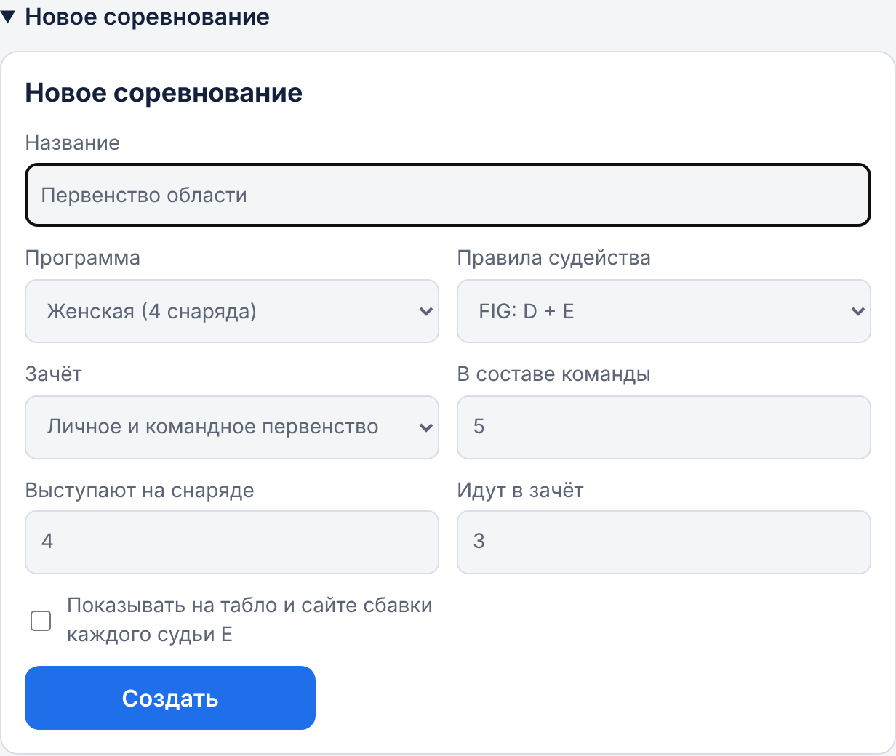

**Следующий турнир — по образцу прошлого.** Когда один турнир уже проведён, следующий удобнее создать блоком **Новое соревнование по образцу прошлого** на том же экране:

1. Откройте блок, выберите **Образец** — прошлый турнир.
2. Впишите **Название нового соревнования**.
3. Нажмите **Создать по образцу**.

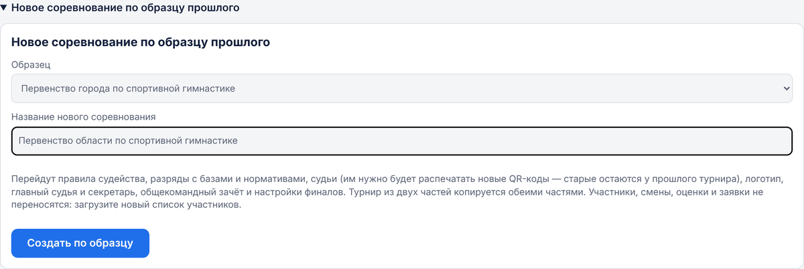

Перейдут правила судейства и допуски, разряды с базами и нормативами, судьи, логотип, главный судья и секретарь, общекомандный зачёт и настройки финалов. Турнир девочек и мальчиков копируется обеими частями. Участники, смены, оценки и заявки не переносятся: загрузите новый список (шаги 6–10). Судьи получают новые коды: распечатайте им **новые QR-коды** на экране **Судьи**, старые остаются у прошлого турнира.

В турнире девочек и мальчиков в списке соревнований одна строка, а под ней появятся кнопки **Девочки** и **Мальчики**. Всё, что вы делаете дальше (судьи, смены, жеребьёвка, протоколы), делается для выбранной части. Перед каждым действием смотрите, какая кнопка горит синим.

## 5. Правила, нормативы, судейская коллегия, сайт

Всё это на экране **Соревнование**, ниже лицензии.

**Правила судейства.** Проверьте, как засчитываются два опорных прыжка: по FIG (в многоборье первый, на снаряде и в финале среднее двух) или «Лучший из двух». Ниже — допуски расхождения сбавок судей E: если судьи E разошлись больше допуска, старший судья увидит предупреждение. Таблица программы — ориентир; если в положении другие допуски, впишите их и нажмите **Сохранить правила**.

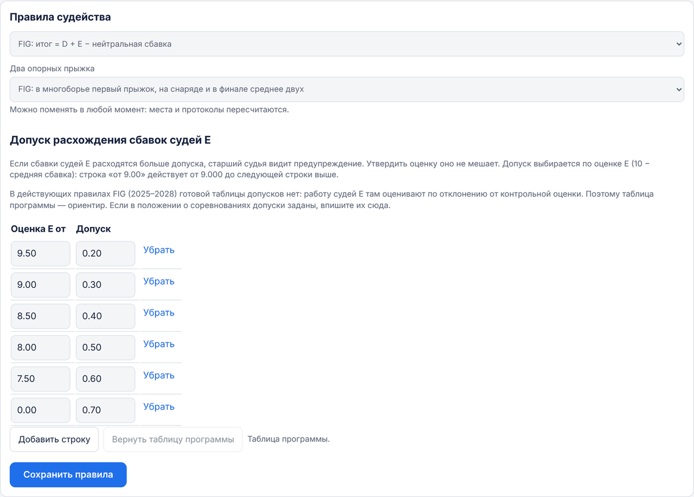

**Нормативы разрядов.** Если на турнире выполняют разряды, нажмите **+ уровень**, впишите название разряда и минимальную сумму многоборья, затем **Сохранить нормативы**. Выполнивший разряд попадёт в протокол многоборья и в список «Выполнили разряды». Нормативы можно поправить и после турнира.

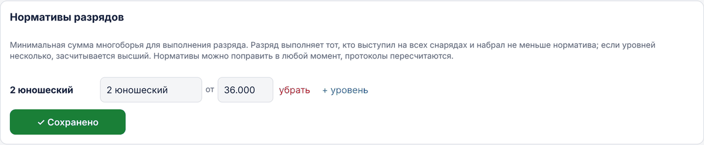

**Главная судейская коллегия.** Впишите ФИО, категорию и город главного судьи и главного секретаря и нажмите **Сохранить**. Они печатаются в подписях под всеми протоколами и на грамотах.

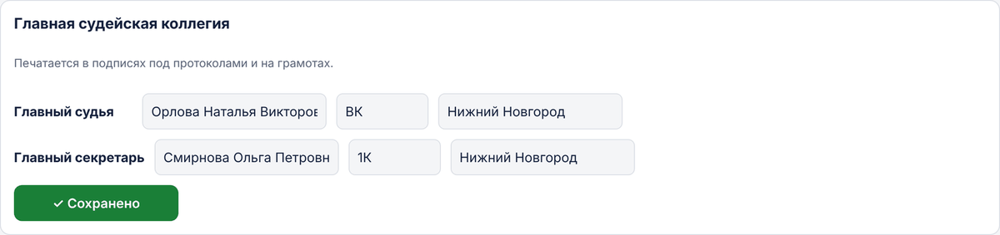

**Результаты на сайте.** Если программа подключена к сайту, в этом блоке нажмите **Отправить на сайт** (или **Отправить ещё раз**). Дальше результаты уходят на сайт сами. Здесь же кнопка **Скопировать шорткод** для страницы WordPress; как вставить табло на сайт, описано в инструкции по установке.

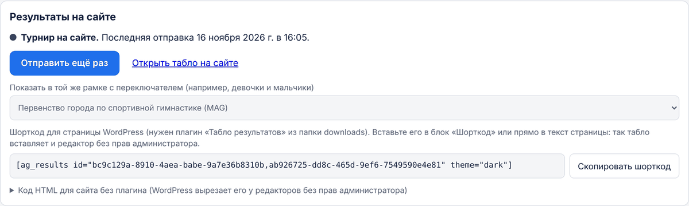

## 6. Онлайн-заявки клубов

Клубы могут подать заявку на сайте, без Excel. Это работает, если программа подключена к сайту.

1. Откройте экран **Участники**, блок **Онлайн-заявки клубов**.
2. При желании укажите **Принимать до** (срок приёма) и нажмите **Открыть приём**.
3. Нажмите **Скопировать ссылку** и разошлите её клубам. Ссылка одна для всех клубов. Её можно поставить на сайт кнопкой «Подать заявку» (**Скопировать шорткод кнопки**).

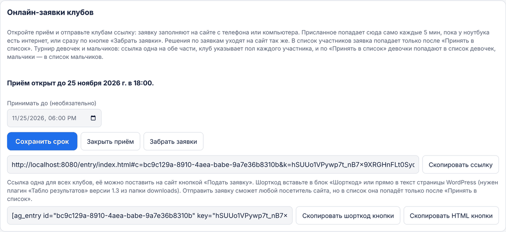

Клуб открывает ссылку на телефоне или компьютере, заполняет клуб, город, контакт и участников. В турнире девочек и мальчиков у каждого участника нужно выбрать **Пол**. Строки можно вставить из Excel кнопкой **Вставить из таблицы**.

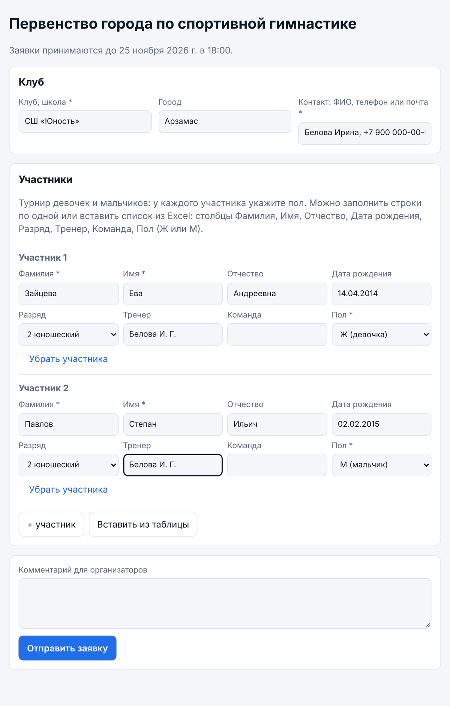

После отправки клуб получает номер заявки и ссылку, по которой видно, рассмотрена ли она.

**Как заявки попадают в секретариат.** Пока у компьютера есть интернет, программа сама забирает заявки каждые 5 минут. Чтобы забрать сразу, нажмите **Забрать заявки**. Каждая заявка видна отдельной карточкой: клуб, контакт, состав с полом, датой рождения, разрядом и тренером.

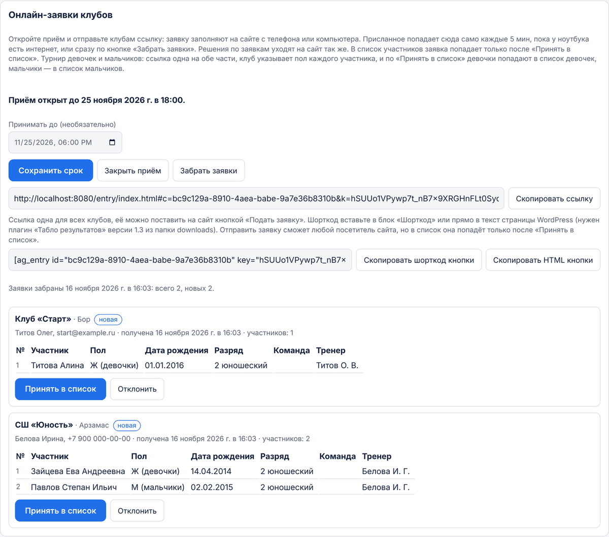

- **Принять в список** — участники попадают в список. В турнире девочек и мальчиков девочки сами попадают в часть «Девочки», мальчики — в «Мальчики».
- **Отклонить** — программа спросит причину. Клуб увидит отказ и причину по своей ссылке.

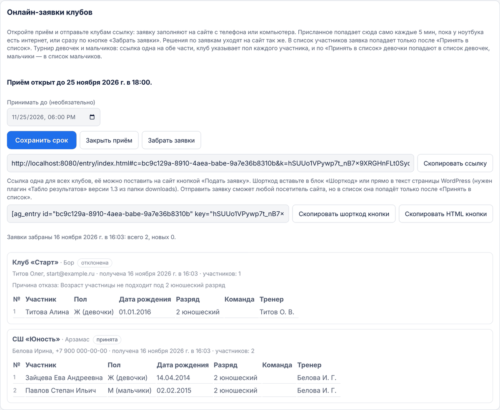

Решения сразу уходят на сайт. Когда срок прошёл или список собран, нажмите **Закрыть приём**.

> Принятые онлайн участники получают номера после последнего и без смены. Смены и номера раздайте потом в блоках **Смены** и **Жеребьёвка** (шаги 9 и 10).

## 7. Заявки в Excel и столбец «Пол»

Если клубы прислали заявки файлами:

1. На экране **Участники** нажмите **Бланк заявки для клубов**, если клубам ещё нужно разослать бланк.
2. Присланный файл загрузите кнопкой **Загрузить заявку Excel**. Заявки нескольких клубов загружайте по очереди: каждая добавляется в конец списка.
3. Программа узнаёт столбцы по заголовкам: Фамилия, Имя (или ФИО), Отчество, Дата рождения, Клуб, Город, Тренер, Команда, Разряд, Смена, Стартовый номер, **Пол**. Над списком она пишет, сколько участников в файле и что пришлось додумать (например, выдала номера по порядку).
4. Список открывается в поле **Вставить список из таблицы или проверить загруженную заявку Excel**. Просмотрите его глазами.
5. В турнире девочек и мальчиков под полем написано, сколько в списке девочек и мальчиков. Столбец **Пол** (Ж или М) решает, в какую часть попадёт участник. Если у кого-то пол не указан, программа покажет номера и не даст добавить список, пока пол не впишут.
6. Нажмите **Добавить из списка N уч.**

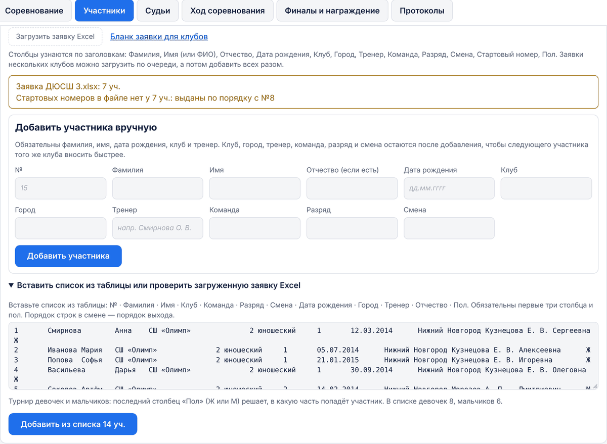

**Вручную.** Одного участника удобно добавить в форме **Добавить участника вручную**: обязательны фамилия, имя, дата рождения (дд.мм.гггг), клуб и тренер. После добавления клуб, город, тренер, разряд и смена остаются в форме, так что участников одного клуба вносить быстро. В турнире девочек и мальчиков сначала выберите нужную часть кнопкой **Девочки** или **Мальчики**.

## 8. Правка участников, неявка и снятие

На экране **Участники** откройте **Список участников: правка, неявка, снятие** и у нужного участника нажмите **Изменить**. Править можно всё: номер, ФИО, дату рождения, клуб, город, тренера, команду, разряд и смену.

- **Неявка или снятие** отмечается в столбце статуса. Такого участника не вызывают на снаряды и не ставят в многоборье. Уже поставленные оценки остаются.
- **Удалить** можно только того, кто ещё не выступал.

## 9. Смены

Смена — группа, которая вместе ходит по снарядам. Если смены указаны в заявках (столбец «Смена»), они уже стоят. Если нет, разделите участников в блоке **Смены** на экране **Участники**:

1. Выберите **Разделить на смены**.
2. Впишите **Сколько смен**.
3. **Как делить**: **Разряды целиком** (каждый разряд в своей смене) или **Поровну, команда не разрывается**.
4. Нажмите **Разделить на смены** и подтвердите.

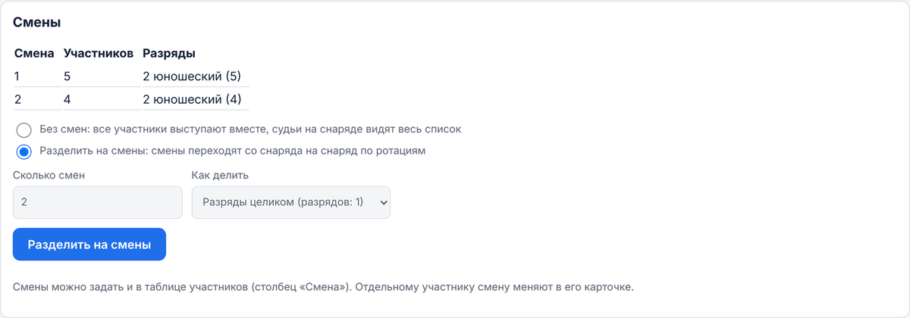

Таблица наверху блока показывает, сколько человек в каждой смене. Строка **без смены** напоминает, что кому-то смена не досталась: например, участникам, принятым онлайн. Если смены не нужны, выберите **Без смен**: тогда все выступают вместе, а судьи видят весь список.

Отдельному участнику смену меняют в его карточке (шаг 8). После первых оценок смены не делятся заново.

## 10. Жеребьёвка

Жеребьёвка раздаёт стартовые номера. Порядок выхода в смене идёт по возрастанию номеров. Проводите её, когда все заявки загружены.

1. Блок **Жеребьёвка** на экране **Участники**.
2. **Номера с** — с какого номера начинать.
3. Галочка **Участники одной команды выступают подряд** — если так по положению.
4. Галочка **Каждая смена с новой сотни** — первая смена получит номера с 101, вторая с 201 и так далее. Так по номеру сразу видно смену.
5. Нажмите **Провести жеребьёвку** и подтвердите.

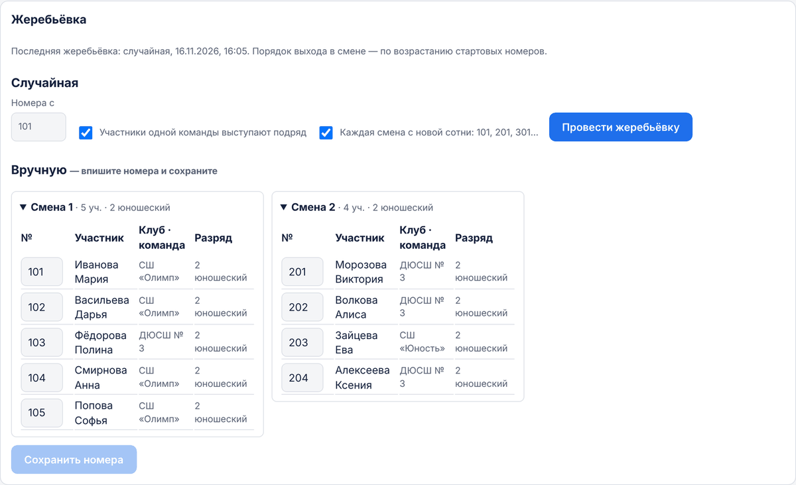

**Вручную.** Номера можно вписать в таблице под заголовком **Вручную** и нажать **Сохранить номера**. После первых оценок номера уже не меняются.

В турнире девочек и мальчиков жеребьёвку проводят в каждой части отдельно. Удобно дать мальчикам свои номера, например с 301, чтобы номера не совпадали.

## 11. Судьи и QR-коды

Экран **Судьи**, форма **Судьи и QR-коды**. Каждого судью заводят отдельно:

1. **ФИО судьи** и **Категория** (ВК, 1К, 2К, 3К, ЮС).
2. **Снаряд**.
3. **Роль**: судья D, судья E или старший судья.
4. **Место в бригаде**: номер судьи E (1, 2, 3…). У судьи D и старшего — 1.
5. **Добавить судью**.

**Один планшет на снаряд.** Чаще всего на снаряде работает один планшет: старший судья вводит оценки всей бригады. Тогда достаточно завести одного старшего судью:

1. Впишите его ФИО и категорию, выберите снаряд и роль **Старший судья**.
2. Поставьте галочку **Один планшет на снаряд**.
3. В появившемся поле **Судьи бригады** впишите судей по одному в строке: сначала судья D, затем E1, E2, E3…
4. Нажмите **Добавить судью**.

QR-код нужен только старшему судье, а фамилии судей D и E попадут в протокол. Можно оставить поле пустым и завести судей D и E отдельно, с ролями «Судья D» и «Судья E», а старшего судью последним.

**Полная бригада.** Если у каждого судьи свой планшет, заведите каждого отдельно без галочки: каждому нужен свой QR-код.

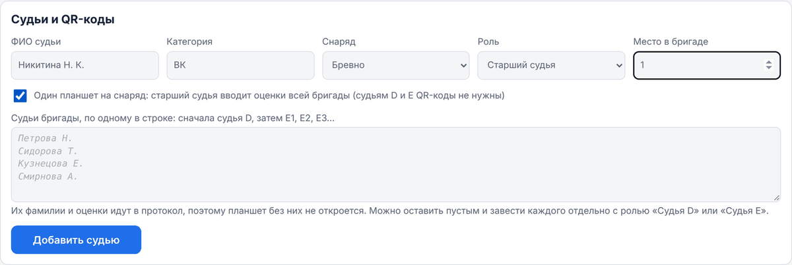

Ниже формы судьи сгруппированы по снарядам. У каждого есть кнопки:

- **Изменить** — поправить фамилию или категорию;
- **Новый QR-код** — если планшет потерян или код попал к постороннему: старый код перестанет работать;
- **Копировать ссылку** — для судьи с ноутбуком без камеры;
- **Удалить**.

**Печать QR-кодов.** Нажмите **Показать QR-коды всех судей**, затем **Печать QR-кодов**. Каждый код подписан снарядом, ролью и фамилией. Перепечатать коды можно в любой момент: они прежние, планшеты продолжат работать.

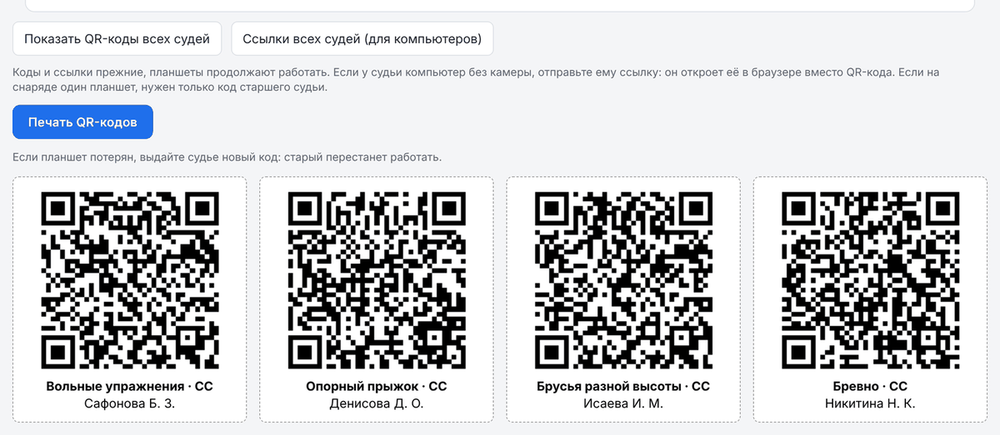

> QR-код содержит адрес компьютера секретариата. Если секретариат открыт по адресу `localhost`, программа предупредит, что с такими кодами планшеты не подключатся. Откройте секретариат по адресу из окна **Запуск** и только потом печатайте коды. Компьютер должен быть подключён к сети зала **до** печати.

**Код главного судьи.** Ниже на этом же экране есть блок **«Главный судья — отдельный планшет или ПК»**: там выдают QR-код главному судье ([шаг 26](#26-вкладка-главный-судья)).

## 12. Планшеты судей и «Разрешить новый планшет»

Судья сканирует свой QR-код камерой планшета, и открывается его страница. Больше ничего вводить не нужно.

На экране **Судьи** блок **Связь судей** показывает, какие планшеты на связи: зелёная точка — на связи, серая — не подключался или пропал. Над блоком написано, сколько планшетов на связи из нужных.

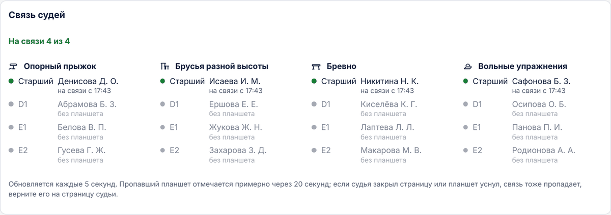

**Заряд планшетов.** Рядом с планшетом на Android виден его заряд: 🔋 — работает от батареи, ⚡ — заряжается. Если заряда 20% или меньше, вверху блока появится красное предупреждение с фамилией судьи и снарядом. Попросите поставить этот планшет на зарядку до следующего выступления. iPad свой заряд браузеру не сообщает, у него значка нет.

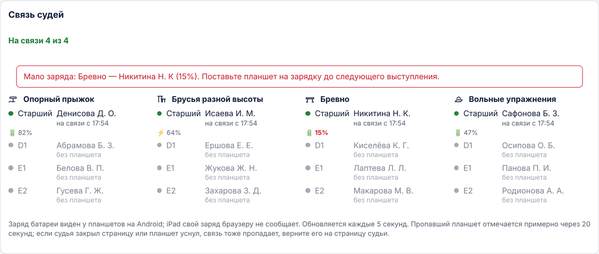

Так выглядит планшет старшего судьи, когда всё готово: снаряд, фамилия, **На связи** и список смены в порядке выхода.

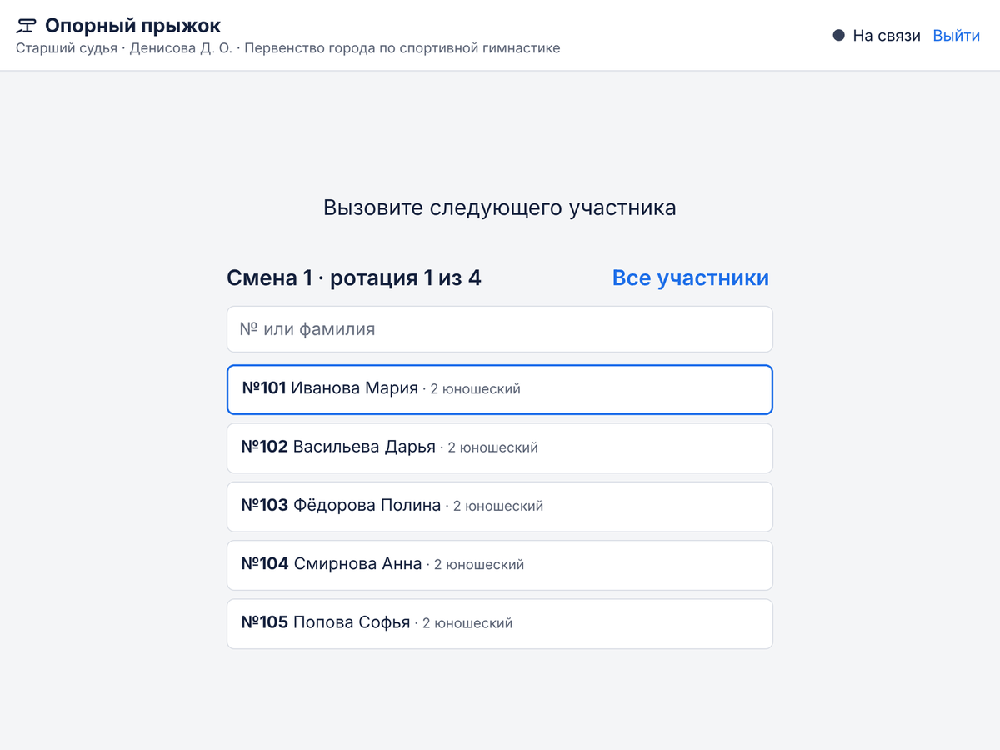

**Код открыли на другом планшете.** QR-код работает только на том планшете, где его открыли первым. Если судья сменил планшет (сел заряд, планшет сломался), новый планшет покажет:

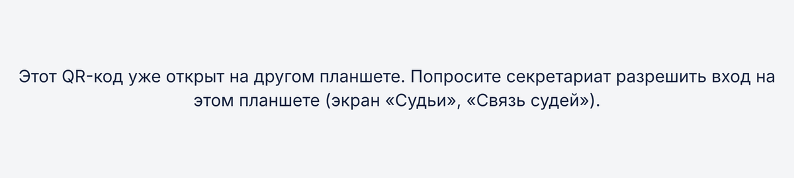

В секретариате на экране **Судьи**, в блоке **Связь судей**, у этого судьи появится красное сообщение и кнопка **Разрешить новый планшет**.

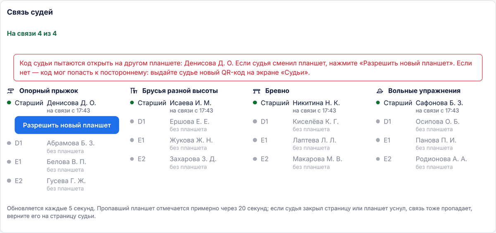

1. Убедитесь, что планшет действительно сменил этот судья.
2. Нажмите **Разрешить новый планшет** и подтвердите.
3. Попросите судью обновить страницу на новом планшете (или снова отсканировать код). Старый планшет код больше не откроет.

Если судья планшет **не** менял, код мог попасть к постороннему. Тогда не разрешайте, а нажмите у этого судьи **Новый QR-код** и выдайте судье новый код.

## 13. Печать перед стартом

Экран **Протоколы**, блок **Перед стартом**:

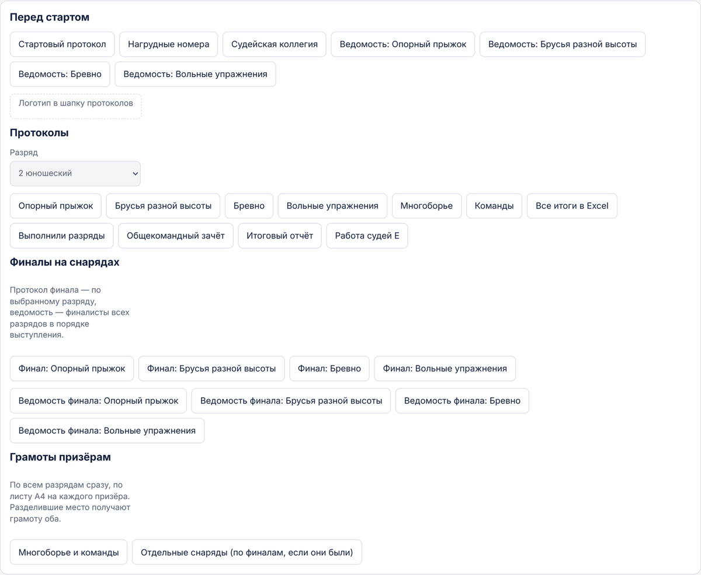

- **Стартовый протокол** — список по сменам и номерам для судейской и для стенда.
- **Нагрудные номера** — по два номера на лист A4, резать по пунктиру.
- **Судейская коллегия** — весь состав судей.
- **Ведомость** по каждому снаряду — бумажный запас на случай, если планшеты откажут: участники в порядке выхода по ротациям и пустые графы для оценок. Раздайте ведомости бригадам.
- **Логотип в шапку протоколов** — любая картинка, программа сама её уменьшит.

## 14. Готовность к старту

Перед началом откройте экран **Ход соревнования**. Вверху блок **Готовность к старту** одним списком проверяет всё сразу: участников, бригады, планшеты на связи, правила, коллегию, связь с сайтом, свежесть резервной копии, прошло ли ежесуточное пробное восстановление из копии и сколько свободно места на диске (подробно — [шаг 31](#31-очистка-после-турниров-место-на-диске)).

- Зелёная галочка — всё в порядке.
- Красный крестик — без этого не начать (например, на снаряде нет судей или планшет не на связи).
- Жёлтый восклицательный знак — стоит проверить (например, турнир ещё не отправлен на сайт или у планшета мало заряда).

Список обновляется сам каждые 10 секунд, а кнопка **Проверить снова** обновляет его сразу. Начинайте, когда вверху написано **Всё готово к старту**.

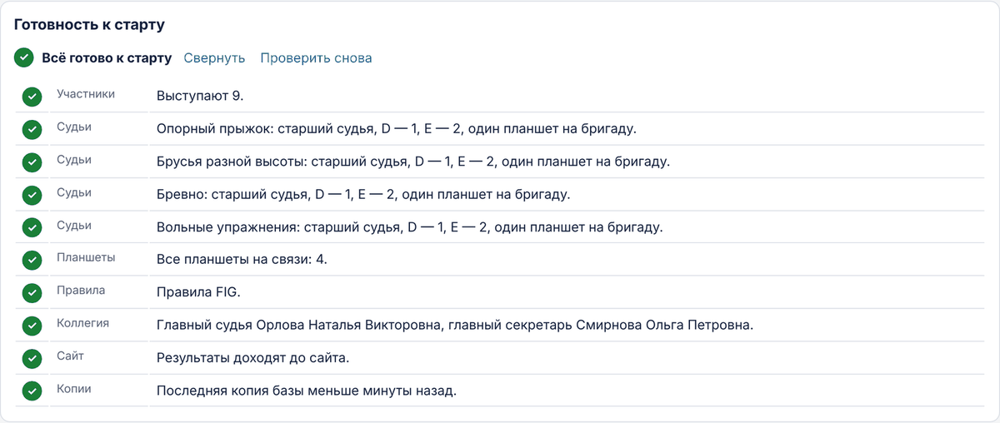

В турнире девочек и мальчиков проверьте готовность в обеих частях.

## 15. Табло в зале и таймер разминки

**Табло в зале.** Табло — это браузер на компьютере, подключённом к экрану в зале, с адресом табло. В турнире девочек и мальчиков в блоке **Табло в зале** выберите, что показывать:

- **Показать: Девочки** или **Показать: Мальчики** — сразу выводит нужную часть;
- **Чередовать каждые …** — части сменяются сами;
- **Вручную на табло** — часть выбирают переключателем на самом табло.

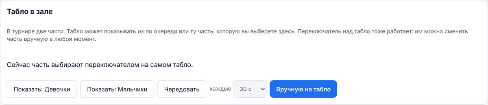

**Таймер на табло.** Для разминки, перехода на снаряды или перерыва в блоке **Таймер на табло** нажмите кнопку с готовым временем (**Разминка 0:30**, **Разминка 0:50**, **Переход на снаряды 2:00**, **Общая разминка 10:00**) или впишите свою **Надпись** и **Время** и нажмите **Запустить**. Рядом видно, сколько осталось.

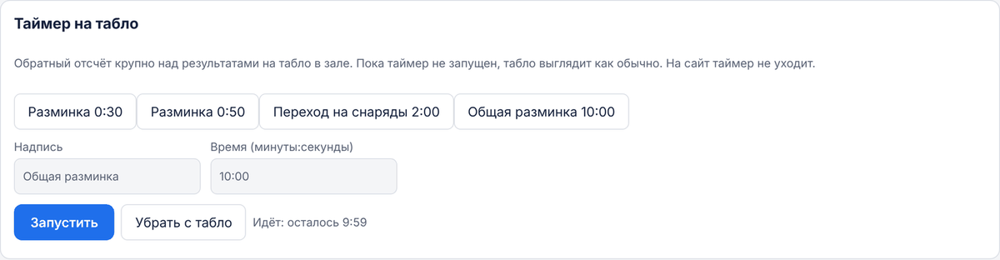

На табло в зале появится крупный обратный отсчёт над результатами. За 10 секунд до конца цифры желтеют, в конце видно «Время!», и через 5 секунд таймер пропадает сам. Остановить раньше — **Убрать с табло**. На сайт таймер не уходит.

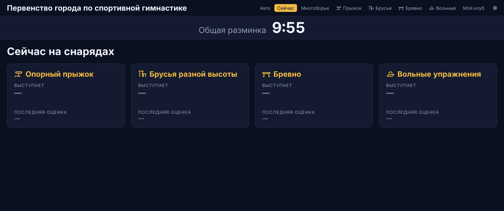

## 16. Ход соревнования: ротации

Соревнование идёт ротациями. На экране **Ход соревнования** блок **Ротация N из M** показывает каждую смену: на каком снаряде она начала, где она сейчас и сколько человек уже выступили.

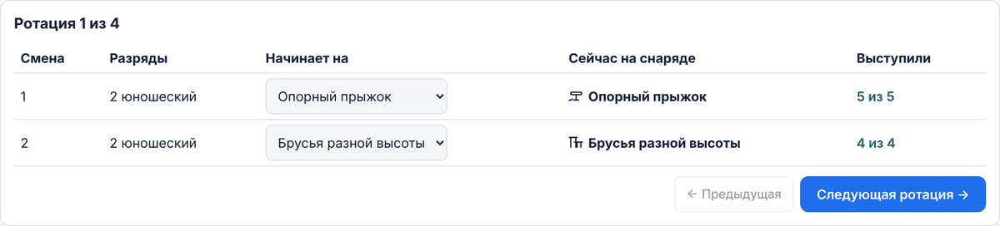

До первых оценок стартовый снаряд смены можно поменять в столбце **Начинает на**.

**Что делает секретарь в каждой ротации:**

1. Следит, как растут цифры **Выступили**. Когда у всех смен стоит зелёное «5 из 5», «4 из 4» и т. д., ротация закончена.
2. Запускает таймер перехода на снаряды, если он нужен.
3. Нажимает **Следующая ротация →**. Планшеты старших судей сами покажут смену, которая пришла на их снаряд. Если кто-то не выступил, программа переспросит.

Кнопка **← Предыдущая** возвращает ротацию назад, если нажали по ошибке. В турнире девочек и мальчиков ротации у каждой части свои: переключайтесь кнопками **Девочки** и **Мальчики**.

Ниже, в блоке **Ход соревнования**, видно, кто сейчас выступает на каждом снаряде и последнюю оценку, а под ним — таблица по разряду со всеми оценками, суммой и местами. Можно выбрать разряд, смену и снаряд. Таблица обновляется сама каждые 5 секунд.

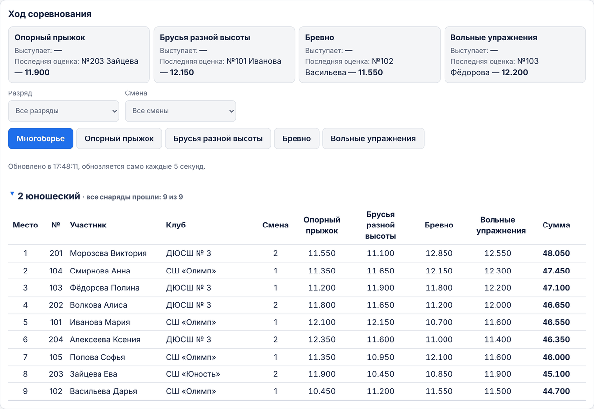

## 17. Как ставит оценки старший судья

Секретарю полезно знать, что видит судья: так проще помочь, если что-то не получается.

1. Старший судья нажимает первого в списке смены (он подсвечен). Опоздавшего или участника из другой смены можно найти через **Все участники** или поиск по номеру.
2. На планшете с одним планшетом на снаряд он вводит D, сбавку каждого судьи E и нейтральную сбавку, если есть. Оценку можно набирать без точки: «34» — это 3.40, «12» — 1.20. Enter переходит к следующему полю.
3. Внизу виден итог. **Утвердить** (или Enter в последнем поле) отправляет оценку на табло, в протоколы и на сайт.

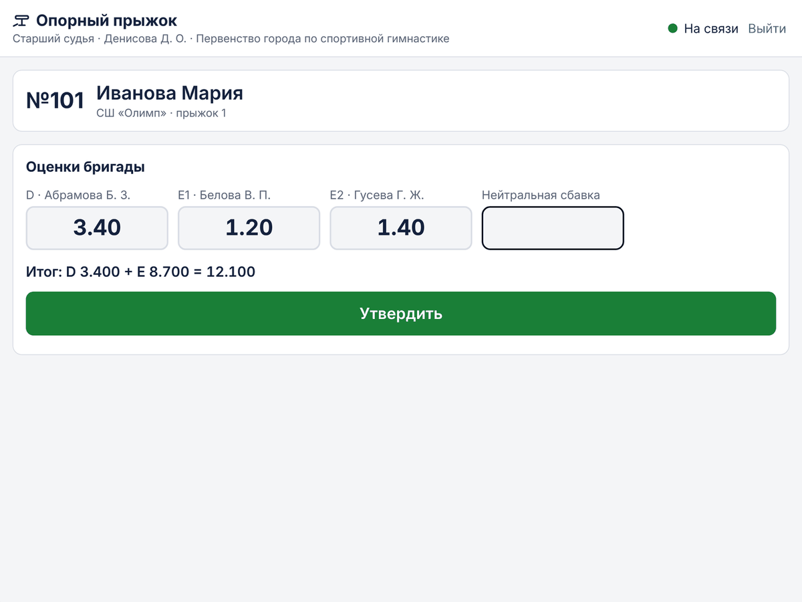

Если сбавки судей E разошлись больше допуска из правил, планшет предупредит жёлтой строкой. Утвердить всё равно можно: это напоминание проверить оценки. На вольных и бревне есть секундомер упражнения.

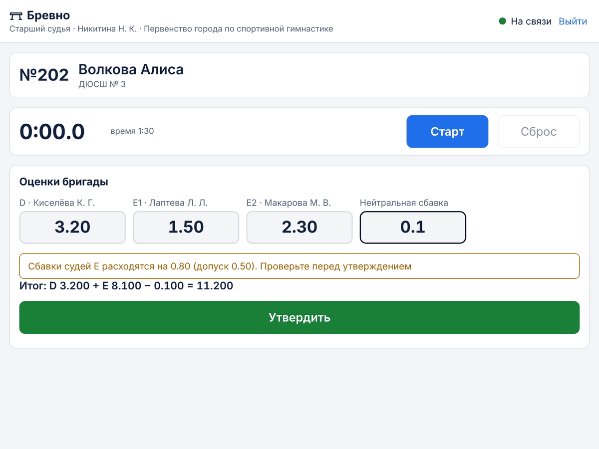

## 18. Экран диктора и «Мой клуб» для тренеров

**Экран диктора.** На экране **Ход соревнования**, блок **Экран диктора**, нажмите **Копировать** и отправьте ссылку диктору. Телефон или ноутбук диктора должен быть в сети зала.

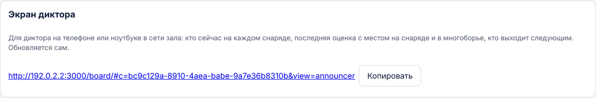

Диктор видит по каждому снаряду, кто выступает, последнюю оценку с местом на снаряде и в многоборье и кто выходит следующим.

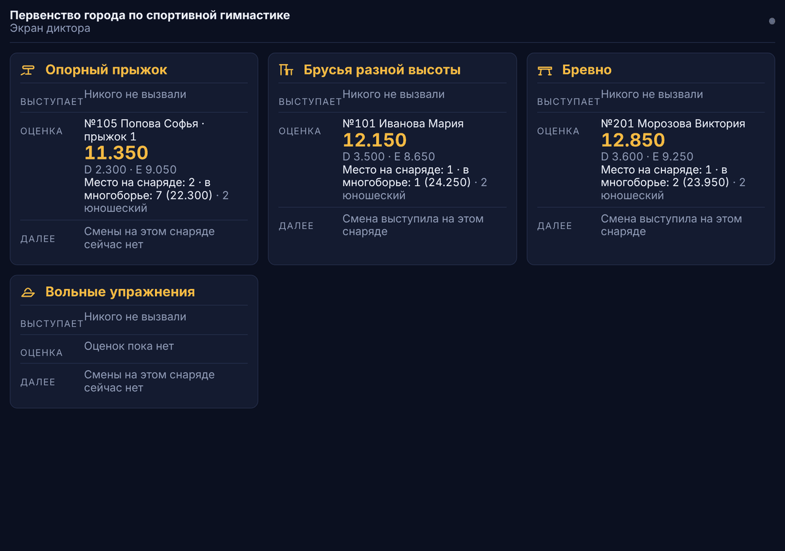

**Голосовой вызов.** Если ноутбук диктора подключён к колонкам зала, нажмите на экране диктора **🔈 Включить голосовой вызов**. Программа сама объявит каждого вызванного участника («Бревно. Выступает номер 103, Сидорова Анна, клуб Олимп.»), а с галочкой **объявлять оценки** — и его оценку после утверждения.

- Говорит встроенный голос браузера, интернет не нужен.
- Нужен русский голос в системе. В Windows 10 и 11 он обычно есть: Параметры → Время и язык → Речь.
- После перезагрузки страницы голос включают снова: браузер разрешает говорить только после нажатия кнопки.

**Табло результатов.** Табло показывает текущие выступления («Сейчас»), многоборье, каждый снаряд, а в режиме «Авто» листает всё по очереди.

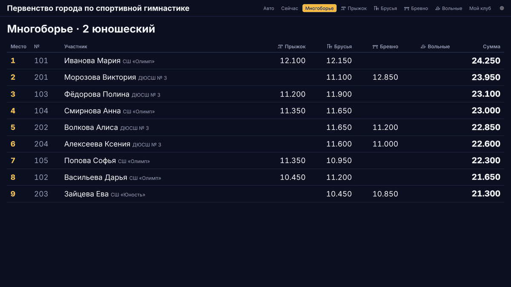

**Тренерам: «Мой клуб».** На табло (в зале или на сайте) есть вкладка **Мой клуб**. Тренер выбирает свой клуб и видит места и оценки всех своих спортсменов. Страница обновляется сама.

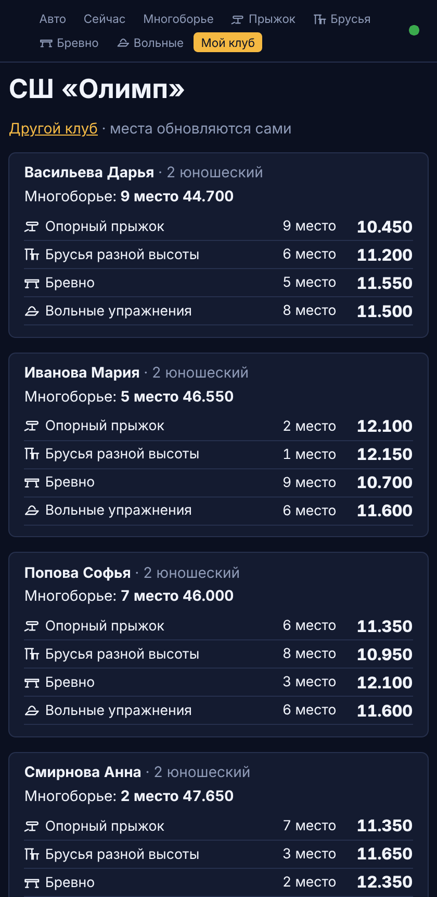

**Прогноз выхода.** Если телефон тренера в сети зала, в карточке спортсмена, который ещё не выступил на текущем снаряде, видно, когда он примерно выйдет: «Опорный прыжок: около 18:50 · через ~4 мин, впереди 2». Тот, кто идёт следующим, помечен «выходит следующим номером», а тот, кто на снаряде, — «Выступает». Участники клуба, у которых ещё нет оценок, тоже видны.

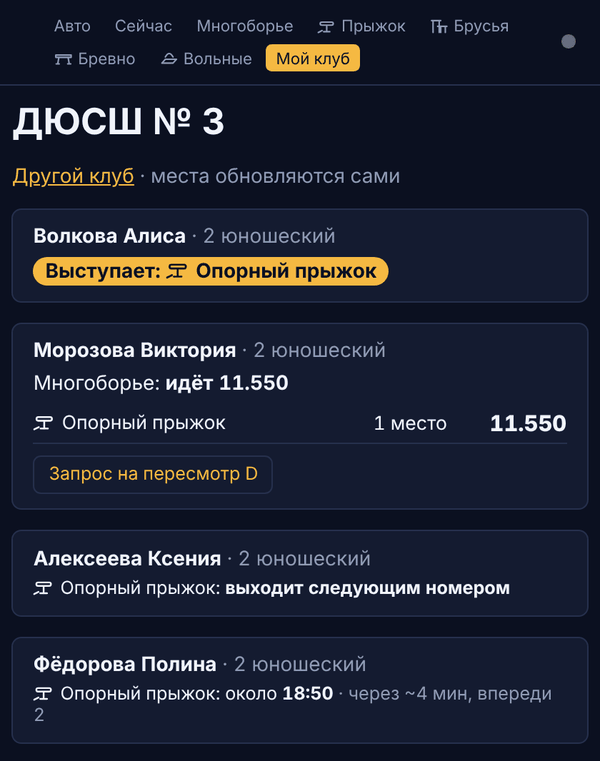

Программа считает по очереди смены и темпу снаряда: сколько в среднем проходит между оценками последних участников (перерывы дольше 10 минут не учитываются; пока оценок мало, берётся полторы минуты на участника). Это прогноз, а не расписание: задержки на снаряде его сдвигают, страница пересчитывает сама. На сайте для зрителей прогноза нет.

## 19. Правка оценок и ввод с судейских листов

Блок **Ввод оценок с судейских листов** на экране **Ход соревнования** нужен в двух случаях:

- планшеты потеряли связь, судьи записали оценки на бумажные ведомости, а секретарь вносит их здесь;
- нужно исправить или удалить уже утверждённую оценку.

Выберите снаряд кнопкой вверху блока. Можно отобрать смену или найти участника по номеру и фамилии.

- **Ввести** — у участника без оценки: впишите D, сбавки E и нейтральную (НС).
- **Исправить** — у участника с оценкой: поправьте числа и нажмите **Сохранить и утвердить**. **Отмена** закрывает правку без изменений.
- **Удалить** — убирает оценку из результатов и протоколов (программа переспросит).

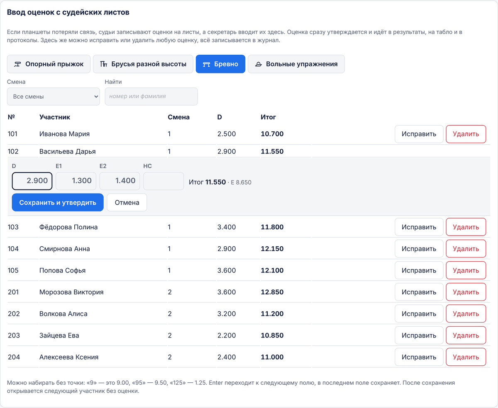

Числа можно набирать без точки, Enter переходит к следующему полю, а в последнем сохраняет. После сохранения открывается следующий участник без оценки. Каждая правка записывается в журнал изменений.

## 20. Запросы тренеров на пересмотр D

Тренер подходит к судейскому столу с запросом. Секретарь записывает его на экране **Финалы и награждение**, блок **Запрос на пересмотр D**:

1. Выберите **Снаряд**.
2. В списке **Выступление** выберите участника: рядом видна его D и итог.
3. Впишите **Тренера** и, если тренер назвал, **D по мнению тренера**.
4. Нажмите **Записать запрос**.

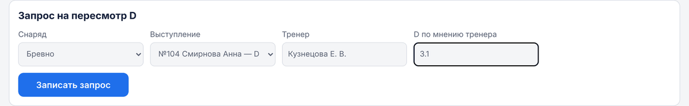

Запрос появится в таблице ниже со статусом «ожидает». Когда бригада приняла решение:

- **Удовлетворить** — программа спросит новую D (подставит ту, что просил тренер). Итог, места, табло и протоколы пересчитаются сами.
- **Отклонить** — оценка останется прежней.

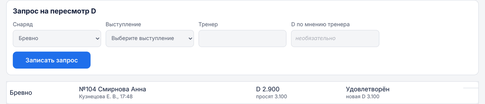

Если запрос подан после положенного срока, в таблице будет пометка «подан после срока». Все решения есть в журнале изменений.

**Запрос с телефона тренера.** Тренер может подать запрос сам, со страницы **Мой клуб** ([шаг 18](#18-экран-диктора-и-мой-клуб-для-тренеров)), если его телефон подключён к сети зала. В карточке спортсмена он нажимает **Запрос на пересмотр D**, выбирает снаряд, пишет фамилию и, если хочет, свою оценку D, и нажимает **Подать запрос**.

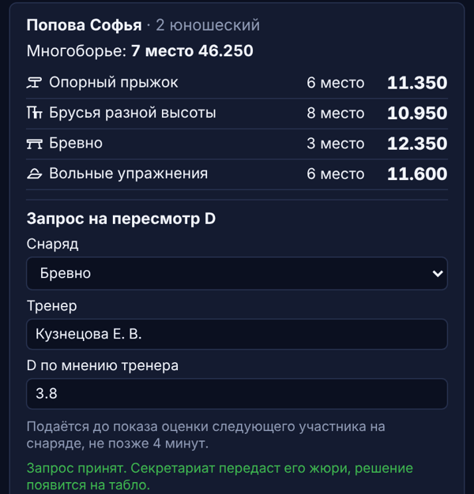

С телефона запрос принимается только в срок: до показа оценки следующего участника на этом снаряде и не позже 4 минут. С одного телефона — не больше 5 запросов за 10 минут. На сайте для зрителей такой кнопки нет. Опоздавший запрос, как и раньше, записывает секретарь со слов тренера.

Запрос с телефона сразу появляется в таблице запросов с пометкой **📱 с телефона тренера** и у главного судьи в списке «Что проверить». Разбирают его так же: **Удовлетворить** или **Отклонить**.

**Запрос у главного судьи.** Если у главного судьи свой экран по QR-коду ([шаг 26](#26-вкладка-главный-судья)), там тот же блок **Запрос на пересмотр D**: главный судья может сам записать запрос и нажать **Удовлетворить** или **Отклонить**. Решение сразу видно и в секретариате, а в журнале изменений оно подписано «Главный судья». Договоритесь заранее, кто вносит решения жюри, чтобы не делать это дважды.

**Видеоповтор.** Если на снаряде стоит камера, в строке запроса есть кнопка **▶ Повтор**: жюри смотрит выступление ещё раз, в замедлении, прежде чем решить ([шаг 29](#29-видеоповторы)).

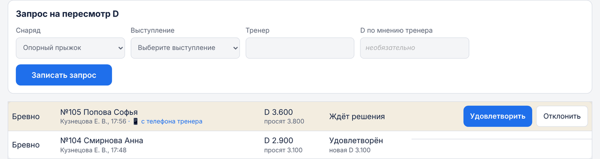

## 21. Сбой: сбор оценок с планшетов

Каждый планшет помнит утверждённые оценки своего снаряда. Это страховка на случай, если базу пришлось восстановить из резервной копии и оценки последних минут пропали.

1. Восстановите копию (см. [шаг 32](#32-если-что-то-пошло-не-так)) и снова запустите программу.
2. Попросите судей включить планшеты и открыть свои страницы. Дождитесь, пока на экране **Судьи** они будут на связи.
3. На экране **Ход соревнования** в блоке **Оценки с планшетов после восстановления** нажмите **Собрать оценки с планшетов**.

Программа напишет, сколько планшетов ответило и сколько выступлений вернулось, и перечислит их. Уже утверждённые на сервере оценки не меняются. На снимке ниже оценку Смирновой на бревне удалили, а планшет бревна вернул её.

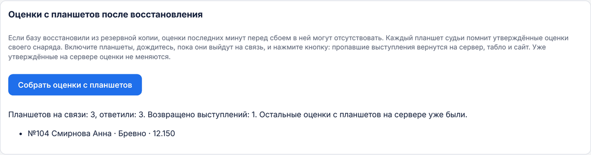

Чего не вернулось, введите по бумажным ведомостям в блоке **Ввод оценок с судейских листов**.

## 22. Финалы и награждение

**Финалы на снарядах** (если они есть в положении). Когда квалификация закончена, на экране **Финалы и награждение** впишите, сколько **Финалистов** и **Запасных**, сколько можно **от клуба**, и нажмите **Сформировать финалы**. Распечатайте **Ведомость финала** по снарядам на экране **Протоколы** и нажмите **Начать финалы**: старшие судьи увидят финалистов в порядке выступления. Если финалист снялся, нажмите **Заменить запасным**.

**Награждение на табло.**

1. Блок **Награждение на табло**: выберите, что награждаете (многоборье, снаряд, командный или общекомандный зачёт) и разряд.
2. Нажмите **Показать на табло**. Под кнопкой появится список призёров для ведущего.
3. Следующее награждение — та же кнопка. После церемонии нажмите **Убрать с табло**.

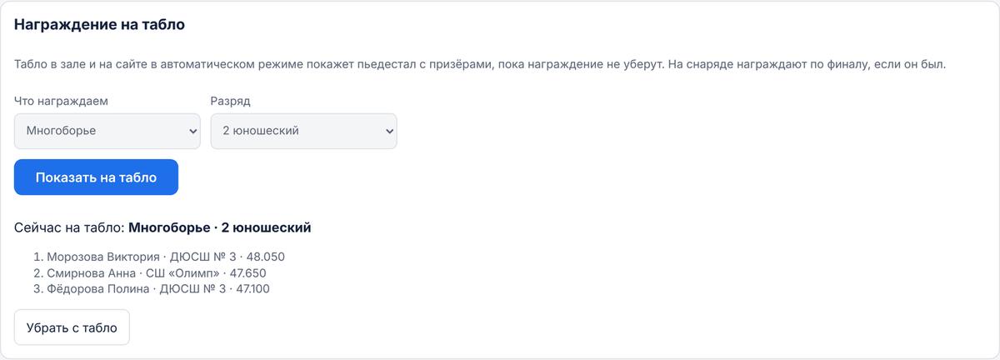

Табло в зале и на сайте в режиме «Авто» покажет пьедестал:

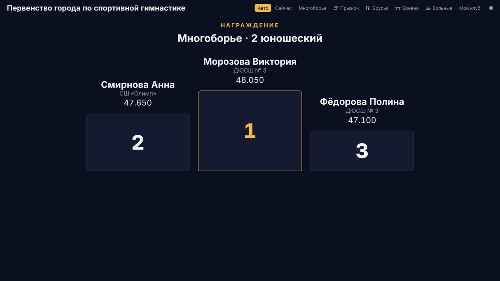

## 23. Протоколы, отчёт о работе судей и архив документов

Экран **Протоколы**, блок **Протоколы**. Выберите **Разряд** и нажмите нужную кнопку: протокол откроется в новой вкладке, его можно распечатать или сохранить.

- **Опорный прыжок**, **Брусья**, **Бревно**, **Вольные** — протоколы снарядов.
- **Многоборье** и **Команды**.
- **Все итоги в Excel** — таблица со всеми итогами.
- **Выполнили разряды** — список для приказа о присвоении.
- **Общекомандный зачёт** — если настроен на экране **Финалы и награждение**.
- **Итоговый отчёт** — для федерации: участники, клубы, призёры, разряды, судьи.
- **Работа судей** — отчёт для главного судьи (подробно ниже).
- **Все документы одним архивом (ZIP)** — один файл со всеми документами турнира (подробно ниже).

Протокол многоборья выглядит так (внизу подписи главного судьи и главного секретаря):

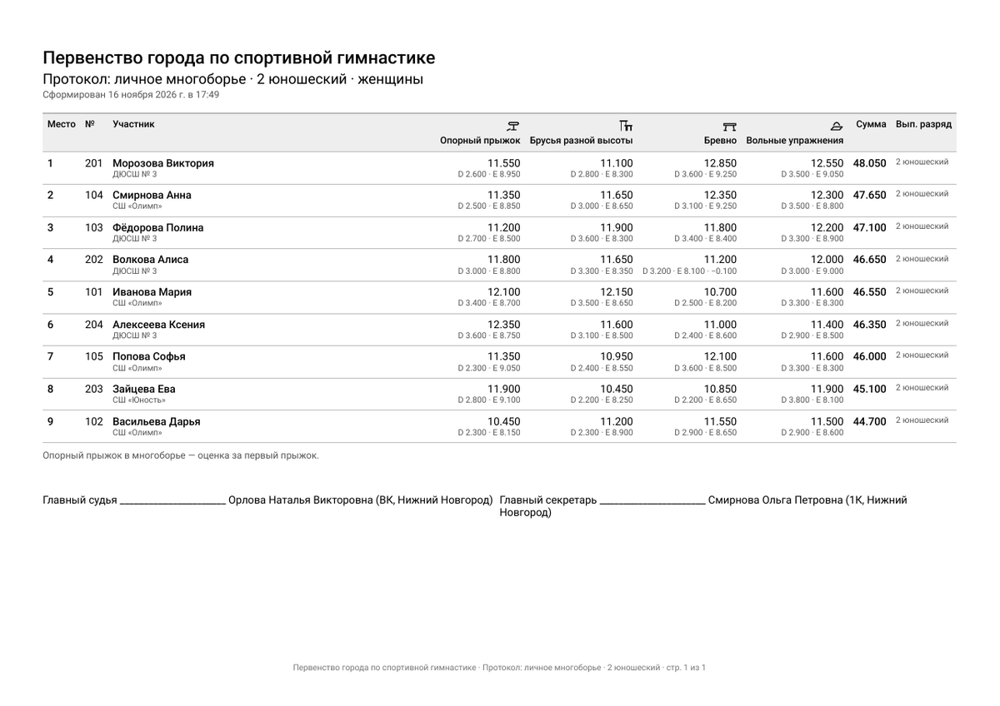

**Работа судей.** Для каждого судьи E в отчёте:

- сколько выступлений он оценил;
- среднее отклонение от итоговой сбавки бригады, строже он бригады или мягче, наибольшее отклонение;
- **Вне допуска** — сколько раз отклонение было больше допуска из «Правил судейства»;
- **Исправлял** — сколько раз судья сам менял отправленную оценку;
- **Ср. время** — сколько в среднем проходило от вызова участника до оценки судьи;
- процент и оценка по таблице FIG.

Ниже таблица **Бригады на снарядах**: сколько выступлений, среднее и наибольшее время от вызова до утверждения оценки, сколько было запросов тренеров, сколько из них изменили D, отклонили и сколько ещё ждут решения.

Процент считается по таблице FIG, но сравнивается с итогом бригады, а не с оценкой экспертов, поэтому это ориентир, а не официальная аттестация.

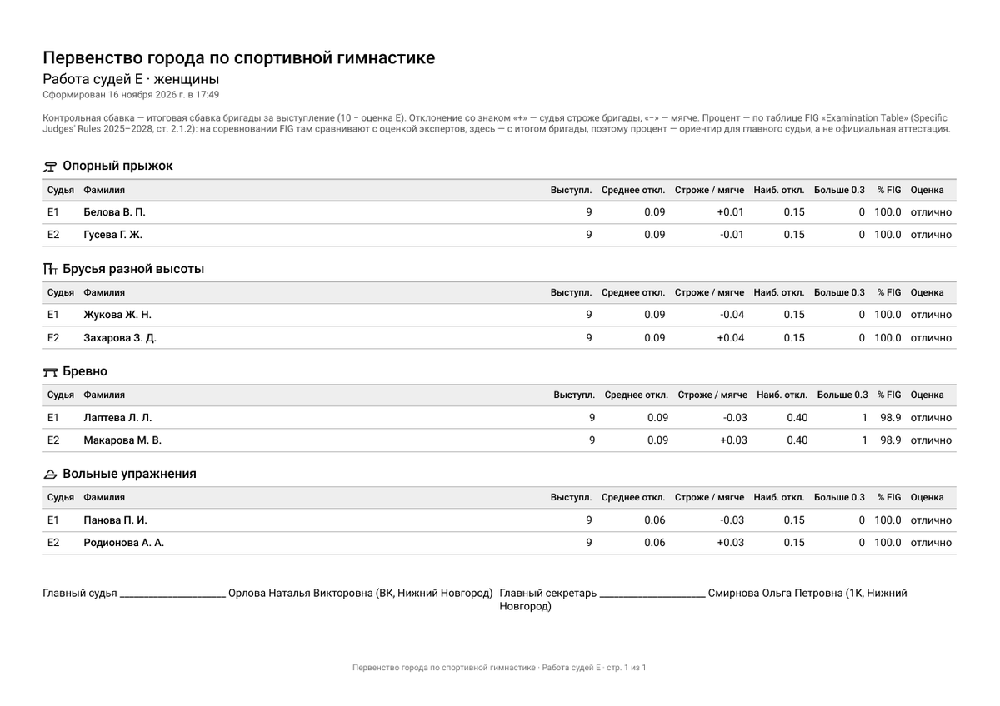

На снимке время почти нулевое: на тестовом турнире оценки ставил скрипт, без пауз. На настоящих соревнованиях там будут реальные секунды и минуты.

**Все документы одним архивом (ZIP).** Кнопка скачивает один файл, в котором всё: стартовый протокол, протоколы по снарядам, многоборье, командное первенство, общекомандный зачёт, финалы (если были), итоги в Excel, выполнившие разряды, судейская коллегия, работа судей, итоговый отчёт и журнал изменений в PDF и Excel. У турнира девочек и мальчиков в архиве по папке на часть. Внутри есть файл «Состав пакета.txt»: если какой-то документ собрать не удалось, там написано почему. Архив удобно отправить в федерацию одним письмом.

**Грамоты призёрам** — в одноимённом блоке, отдельно за многоборье и команды и за отдельные снаряды. По листу A4 на каждого призёра.

## 24. Результаты и протоколы на сайте

**Результаты** уходят на сайт сами, сразу после каждой утверждённой оценки, если в шаге 5 турнир отправлен на сайт. Значок **Сайт** вверху секретариата должен быть зелёным. Если в зале пропал интернет, зал работает дальше, а на сайт всё уйдёт, когда связь вернётся.

Так табло выглядит на странице сайта:

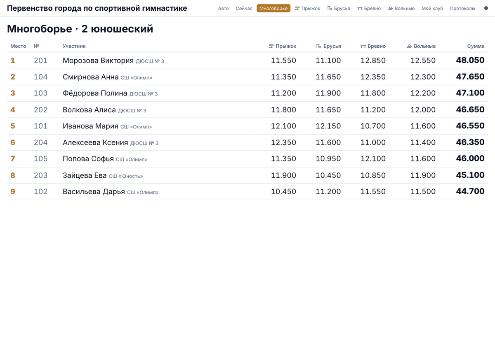

**Протоколы на сайте.** После соревнований (или после каждого вида) на экране **Протоколы** в блоке **Протоколы на сайте** нажмите **Выложить на сайт**. Протоколы каждого разряда, общекомандный зачёт и итоги в Excel появятся на сайте во вкладке «Протоколы». Ссылку **Открыть на сайте** можно разослать клубам.

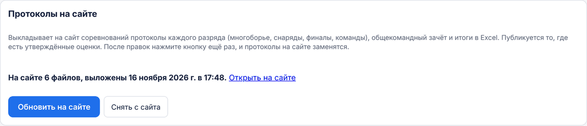

После правок нажмите **Обновить на сайте**, и файлы заменятся. **Снять с сайта** убирает их.

## 25. Журнал изменений

Внизу экрана **Протоколы** блок **Журнал изменений** показывает, кто и когда ставил, правил и утверждал оценки, разбирал запросы тренеров, менял участников и настройки. Новые записи сверху. Можно выбрать раздел: оценки, запросы тренеров, участники, организация.

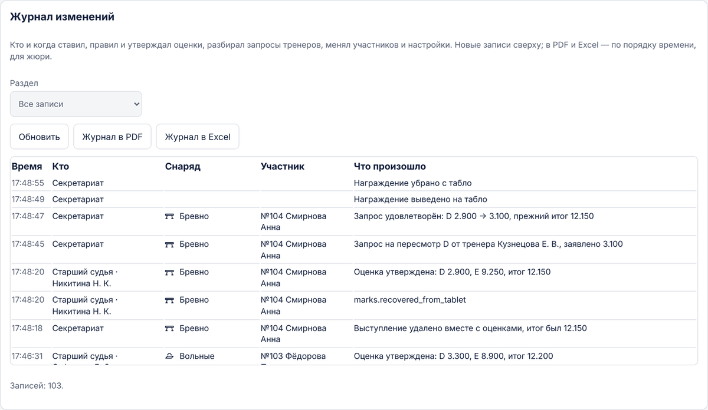

Если жюри просит разобраться со спорной оценкой, нажмите **Журнал в PDF** (с подписями главного судьи и главного секретаря) или **Журнал в Excel**.

## 26. Вкладка «Главный судья»

Главный судья работает на **своём** планшете или ноутбуке, без пароля секретариата. На вкладке **Судьи** в блоке **«Главный судья — отдельный планшет или ПК»** нажмите **«Выдать код главного судьи»**, затем **«Показать QR-код»** и отсканируйте его планшетом главного судьи (или **«Скопировать ссылку»** и откройте её на ноутбуке в сети зала). На его экране: все снаряды сразу, список «Что проверить» и блок запросов тренеров — там же главный судья записывает запрос и вносит решение жюри. Менять турнир, оценки и судей с этого экрана нельзя. У турнира девочек и мальчиков код один на обе части, переключатель «Девочки | Мальчики» есть на его экране. Если код попал не в те руки, нажмите **«Новый код»**: прежний перестанет работать. В журнале изменений решения с этого экрана подписаны «Главный судья».

Так выглядит экран на планшете главного судьи: вверху снаряды и «Что проверить», ниже запросы тренеров с кнопками решения.

Та же картина есть и в секретариате на вкладке **Главный судья**:

- **Сейчас на снарядах** — все снаряды сразу: кто выступает, сколько оценок E уже пришло, сколько прошло с вызова, последняя оценка.
- **Что проверить** — запросы тренеров, которые ждут решения; оценки, которые ставят дольше 2 минут; расхождения сбавок E сверх допуска; нейтральные сбавки.

Если в зале стоят камеры, у последней оценки каждого снаряда и у отметок «Что проверить» есть кнопка **▶ Повтор**, а внизу — блок **Видеоповторы** с последними выступлениями ([шаг 29](#29-видеоповторы)) Эти кнопки есть и на собственном экране главного судьи.

Список обновляется сам. В секретариате решения по запросам принимают на вкладке **Финалы и награждение**, а оценку исправляют на вкладке **Ход соревнования** в блоке **Ввод оценок с судейских листов**.

## 27. Запасной ноутбук

Если есть второй ноутбук, держите его в резерве: тогда поломка основного почти ничего не стоит.

1. Установите программу на второй ноутбук так же, как на основной, и введите лицензию. Подключите его к той же сети Wi-Fi.
2. На втором ноутбуке откройте секретариат, экран **Соревнование** → **Запасной ноутбук**.
3. Впишите адрес секретариата основного ноутбука (например, `http://192.168.1.23:3000`) и его токен (строка `ADMIN_TOKEN` в файле `.env` основного ноутбука). Нажмите **Включить резерв**.
4. Запасной ноутбук каждые 15 секунд забирает с основного все турниры. Строка «Последняя копия: … с назад» показывает, что резерв работает.

**Если основной ноутбук сломался:**

1. На запасном нажмите **Основной сломался — продолжить на этом ноутбуке**. Турниры загрузятся с теми же QR-кодами.
2. Открытые страницы судей примерно через минуту сами найдут новый адрес и дошлют оценки, которых не было в копии.
3. Табло в зале откройте по адресу запасного ноутбука.
4. На экране **Ход соревнования** нажмите **Собрать оценки с планшетов** ([шаг 21](#21-сбой-сбор-оценок-с-планшетов)).

> Не нажимайте эту кнопку, пока основной ноутбук работает: судьи могут оказаться на двух ноутбуках сразу.

Планшеты находят сервер и без запасного ноутбука: если у компьютера секретариата поменялся адрес в той же сети (например, роутер выдал другой после перезагрузки), открытые страницы судей примерно через 40 секунд без связи сами найдут его по новому адресу. Надёжнее всего закрепить адрес компьютера в настройках роутера, как описано в инструкции по установке.

## 28. Новая версия программы

Если у ноутбука сервера есть интернет, программа раз в 6 часов сама проверяет, не вышла ли новая версия. Когда она выходит, над вкладками секретариата появляется сообщение с коротким списком, что нового.

Обновляйтесь **после** турнира, не во время соревнований: на ноутбуке сервера дважды щёлкните `Обновить.bat`. Турниры и настройки сохранятся. Кнопка **Скрыть до следующей версии** убирает сообщение.

Какая версия стоит сейчас, написано внизу экрана **Соревнование**. Там же кнопка **Проверить сейчас**.

## 29. Видеоповторы

Если в зале на снарядах стоят IP-камеры, программа сама записывает каждое выступление, и спорную оценку можно пересмотреть на видео. **Камер может и не быть** — тогда кнопок «Повтор» просто нет, и всё работает как обычно. Камеры могут стоять не на всех снарядах. Как купить и подключить камеры, описано в инструкции по установке, раздел «Видеоповторы с IP-камер».

**Перед стартом.** Экран **Соревнование** → блок **Камеры видеоповторов**. Напротив каждого снаряда с камерой должно быть зелёное **«пишет»**. Кнопка **Кадр** показывает, что видит камера: снаряд должен быть виден целиком. Камеры вводятся один раз для зала, в каждом турнире заново их вписывать не нужно. В **Готовности к старту** тоже есть строка «Видеоповторы».

**Как получается ролик.** Судьям ничего нажимать не нужно. Ролик идёт от вызова участника (с запасом 5 секунд) до первой оценки судьи (плюс 10 секунд). Он готов через 10–20 секунд после того, как оценку утвердили.

**Где смотреть:**

- вкладка **Главный судья**: кнопка **▶ Повтор** у последней оценки каждого снаряда, у отметок в «Что проверить» и в блоке **Видеоповторы** (последние 12 выступлений);
- экран **Финалы и награждение**, таблица запросов тренеров: кнопка **▶ Повтор** в строке запроса.

**Проигрыватель.** Ролик начинается сам. Кнопки **0.25×** и **0.5×** замедляют, **1×** — обычная скорость. **◀ кадр** и **кадр ▶** двигают видео на кадр назад и вперёд, на паузе. Если в ролик попало не всё (участник начал позже или ролик кончился раньше), нажмите **Шире ±30 с**: программа добавит по 30 секунд до и после. Закрыть — **✕** или клавиша Esc.

Для большого экрана жюри откройте секретариат на отдельном ноутбуке или телевизоре (вход тем же паролем) и разверните видео на весь экран кнопкой в проигрывателе.

**Если камера сломалась.** Рядом с камерой в блоке «Камеры видеоповторов» и у главного судьи будет написано «не пишет» и причина. Судить можно дальше, просто на этом снаряде не будет повторов. Камера сама переподключится, когда снова появится в сети. Если у выступления пишет «Камера не записывала во время выступления» — в это время камера была отключена.

**После турнира.** В блоке «Камеры видеоповторов» нажмите **Скачать ролики турнира одним архивом**: браузер скачает ZIP-архив, в нём ролики названы понятно, например `Бревно №11 Иванова Анна.mp4` (ролик «шире» — `Бревно №11 Иванова Анна (шире).mp4`). Архив можно отдать жюри или тренерам. Ролики хранятся 14 дней и удаляются сами; освободить место сразу можно кнопкой **Удалить ролики турнира**.

Ролики лежат и в папке программы: `video\clips\<название турнира> [номер]\Бревно №11 Иванова Анна [номер].mp4`. Номер в квадратных скобках служебный, его не трогайте. Открытый повтор можно сохранить и из проигрывателя: правая кнопка мыши → «Сохранить видео как…», имя будет понятным.

## 30. После соревнований

1. Распечатайте протоколы по разрядам и грамоты.
2. Распечатайте **Выполнили разряды** и **Итоговый отчёт**, если нужны.
3. Скачайте **Все документы одним архивом (ZIP)**: в нём протоколы, итоги в Excel, отчёты и журнал.
4. Выложите протоколы на сайт (шаг 24).
5. Если были камеры, скачайте ролики архивом ([шаг 29](#29-видеоповторы)): через 14 дней они удалятся сами.
6. На экране **Соревнование** в блоке **Перенос и удаление турнира** нажмите **Выгрузить в файл** и сохраните файл турнира на флешку вместе с последней копией базы из папки `backups`.
7. Ничего не удаляйте вручную: лишние копии базы программа удалит сама через 30 дней ([шаг 31](#31-очистка-после-турниров-место-на-диске)).

## 31. Очистка после турниров: место на диске

Во время турнира программа каждые 5 минут снимает копию базы в папку `backups`. За день набирается до 288 файлов, это сотни мегабайт. Чистить их вручную не нужно: программа делает это сама.

**Что удаляется само.**

- **Лишние копии базы.** Пока в программе ничего не меняется, новые копии не снимаются. Если ничего не менялось 30 дней, удаляются все копии, кроме **12 самых свежих**. В этих 12 копиях лежат все турниры целиком. Программа проверяет это раз в 6 часов.
- **Старые сборки программы**, оставшиеся после обновлений, удаляются при каждом **Запуске** и **Обновлении**.
- **Журналы программы** не растут больше 30 МБ.
- **Видеоповторы**: запись с камер хранится 3 часа, ролики выступлений — 14 дней ([шаг 29](#29-видеоповторы)).

**Что остаётся навсегда:** турниры в программе, протоколы, результаты и файлы турниров в папке `backups\tournaments`. Файлы старых турниров оттуда можно удалить вручную, если они сохранены на флешке или в другом месте.

**Где это видно и настраивается.** Экран **Соревнование**, раскрывающийся блок **Очистка после турниров**. В нём видно, сколько копий и сколько места они занимают, когда в программе было последнее изменение и когда сработает автоудаление.

- **Удалять лишние копии через, дней** — срок после последнего изменения в программе (по умолчанию 30). Впишите другое число и нажмите **Сохранить срок**. 0 — не удалять автоматически.
- **Очистить сейчас** — сразу удалить все копии, кроме 12 самых свежих. Удобно, если место нужно сегодня. После очистки видно, сколько копий удалено и сколько места освобождено.

> Не нажимайте **Очистить сейчас** во время турнира: 12 свежих копий — это всего последний час работы. Чистите после того, как турнир выгружен в файл и сохранён на флешку.

**Место на диске.** В **Готовности к старту** есть строка **Диск**: если свободно меньше 5 ГБ, она жёлтая, меньше 1 ГБ — красная. Если места меньше 2 ГБ, программа удаляет старые копии раньше срока, но последние 12 оставляет всегда. Там же строка о ежесуточном пробном восстановлении: раз в сутки программа сама проверяет, что из свежей копии базу можно восстановить.

## 32. Если что-то пошло не так

| Что случилось | Что делать |
| --- | --- |
| Планшет пишет «Нет связи» | Проверьте Wi-Fi на планшете. Оценки, поставленные без связи, планшет хранит и отправит сам, когда связь вернётся. |
| «Этот QR-код уже открыт на другом планшете» | Судья сменил планшет: экран **Судьи** → **Связь судей** → **Разрешить новый планшет** ([шаг 12](#12-планшеты-судей-и-разрешить-новый-планшет)). Если судья планшет не менял, нажмите у него **Новый QR-код**. |
| Планшет не открывает QR-код | Планшет и компьютер секретариата должны быть в одной сети. На компьютере выключите VPN. Подробно — в инструкции по установке, раздел «Если что-то не работает». |
| Планшеты не работают совсем | Судьи пишут оценки в бумажные ведомости, секретарь вводит их в блоке **Ввод оценок с судейских листов** ([шаг 19](#19-правка-оценок-и-ввод-с-судейских-листов)). |
| Секретариат не пускает: «Слишком много неверных паролей» | Подождите 15 минут или войдите токеном из окна запуска. |
| Компьютер секретариата выключился | Включите и снова запустите **Запуск**. Данные сохранились, планшеты переподключатся сами. |
| Компьютер секретариата сломался | Если есть запасной ноутбук, нажмите на нём **Основной сломался — продолжить на этом ноутбуке** ([шаг 27](#27-запасной-ноутбук)). Иначе восстановите копию на другом ноутбуке по инструкции в `docs/competition-day.md`: планшеты в той же сети Wi-Fi сами найдут новый адрес. |
| Планшет пишет, что мало заряда, или в «Связи судей» красное предупреждение | Поставьте планшет на зарядку до следующего выступления ([шаг 12](#12-планшеты-судей-и-разрешить-новый-планшет)). |
| Удалили не то или база повреждена | Восстановите последнюю копию: `scripts\restore.ps1` в папке программы. Данные откатятся не дальше чем на 5 минут. Затем **Собрать оценки с планшетов** ([шаг 21](#21-сбой-сбор-оценок-с-планшетов)). |
| Камера видеоповторов «не пишет» | Судите дальше как обычно, на этом снаряде просто не будет повтора. Причина написана рядом с камерой на экране **Соревнование**; что делать, есть в инструкции по установке, раздел «Видеоповторы с IP-камер». |
| В «Готовности к старту» жёлтая или красная строка «Диск» | Мало места. Экран **Соревнование** → **Очистка после турниров** → **Очистить сейчас** (не во время турнира), удалите ролики прошлых турниров, старые файлы из `backups\tournaments` перенесите на флешку ([шаг 31](#31-очистка-после-турниров-место-на-диске)). |
| Табло на сайте не обновляется | Проверьте интернет в зале. Зал работает и без него, на сайт всё уйдёт, когда связь вернётся. |
| Ошибка в фамилии или разряде | Экран **Участники** → **Список участников** → **Изменить** ([шаг 8](#8-правка-участников-неявка-и-снятие)). Протоколы пересчитаются сами. |

Резервная копия базы снимается каждые 5 минут в папку `backups`, а каждые полчаса каждый турнир сохраняется файлом в `backups\tournaments`. В перерывах копируйте свежие файлы на флешку. Лишние копии программа потом удалит сама ([шаг 31](#31-очистка-после-турниров-место-на-диске)).

## 33. Шпаргалка на день турнира

**Накануне**

- [ ] Войти паролем, лицензия действует.
- [ ] Соревнование создано, правила, нормативы и коллегия заполнены, турнир отправлен на сайт.
- [ ] Онлайн-приём закрыт, заявки Excel загружены, у всех участников есть смена.
- [ ] Жеребьёвка проведена, стартовый протокол распечатан.
- [ ] Судьи заведены, QR-коды напечатаны по адресу из окна **Запуск**, главному судье выдан свой код.
- [ ] Распечатаны нагрудные номера и судейские ведомости.

**Утром в зале**

- [ ] Компьютер в сети зала, **Запуск** выполнен, значок **Сайт** зелёный.
- [ ] Запасной ноутбук включён в резерв (если есть).
- [ ] Судьи отсканировали коды, на экране **Судьи** все планшеты на связи.
- [ ] **Готовность к старту**: «Всё готово к старту» (в обеих частях), строка **Диск** зелёная.
- [ ] Табло в зале, ссылка диктору (и голосовой вызов, если есть колонки), главный судья отсканировал свой QR-код.
- [ ] Планшеты заряжены: в **Связи судей** нет красного предупреждения.
- [ ] Если есть камеры: в блоке **Камеры видеоповторов** везде «пишет», **Кадр** показывает снаряд целиком.

**Во время соревнований**

- [ ] Таймер разминки → ротация → **Следующая ротация →**.
- [ ] Запросы тренеров записываются и разбираются.
- [ ] В перерывах копия на флешку.

**После**

- [ ] Награждение на табло.
- [ ] Протоколы, грамоты, отчёт «Работа судей», архив всех документов (ZIP).
- [ ] Протоколы выложены на сайт, турнир выгружен в файл.
- [ ] Если были камеры: **Скачать ролики турнира одним архивом**.
- [ ] Если было сообщение о новой версии — обновиться через `Обновить.bat`.
- [ ] Копии базы вручную не удалять: через 30 дней лишние удалятся сами.
