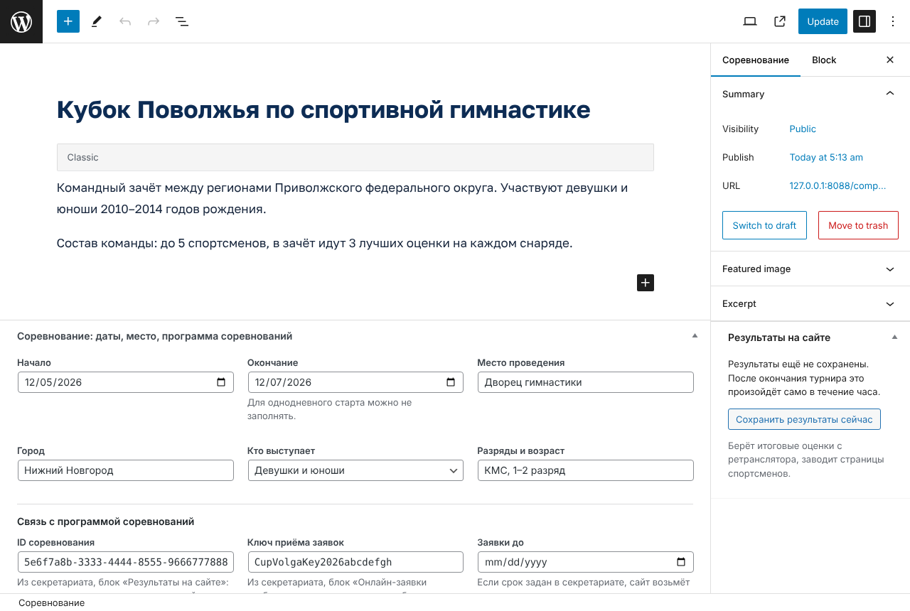
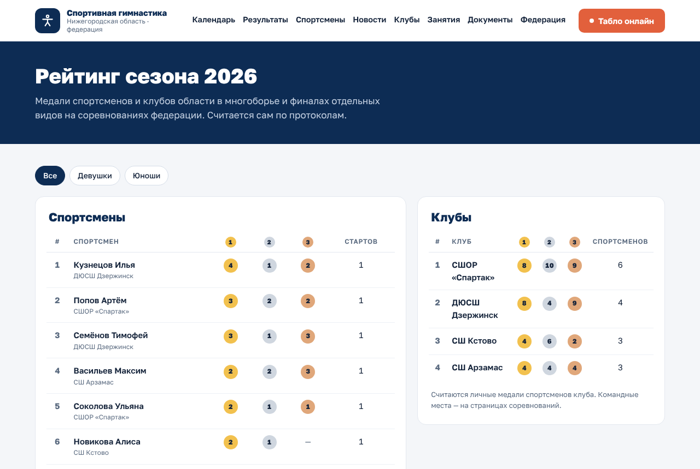
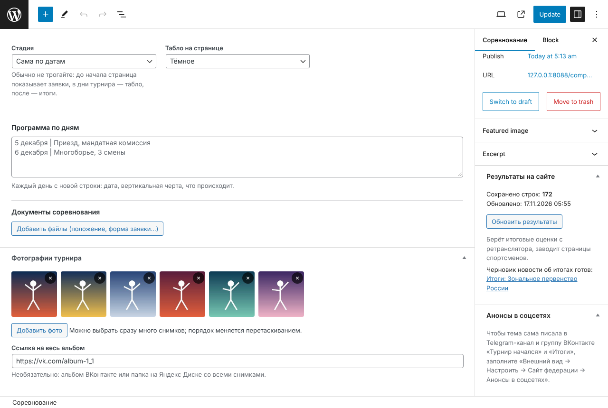
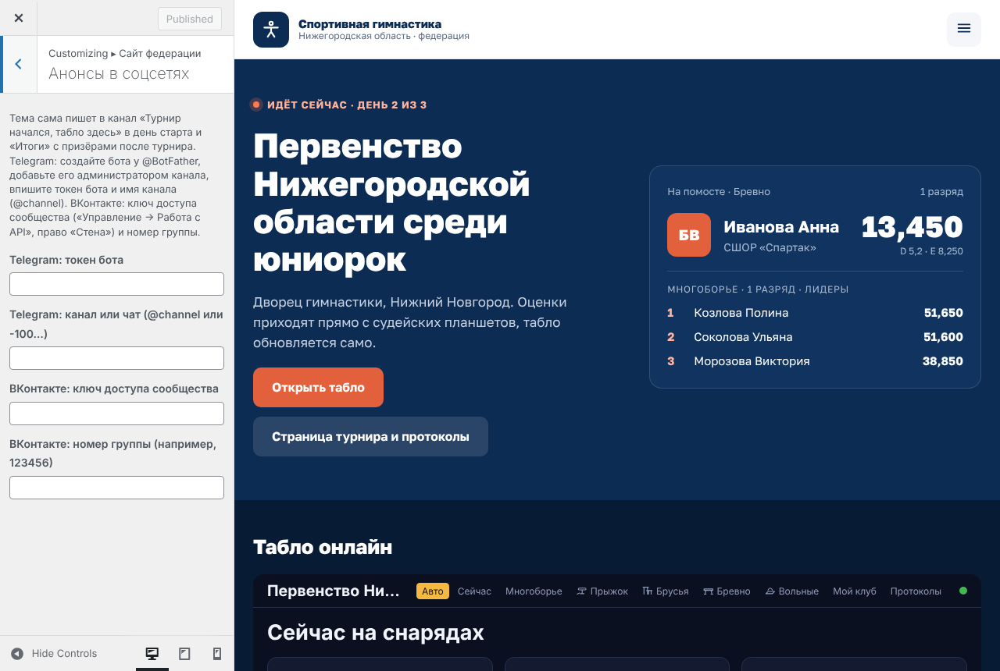
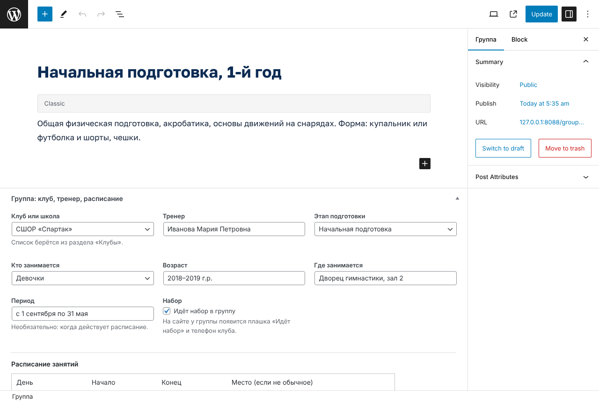
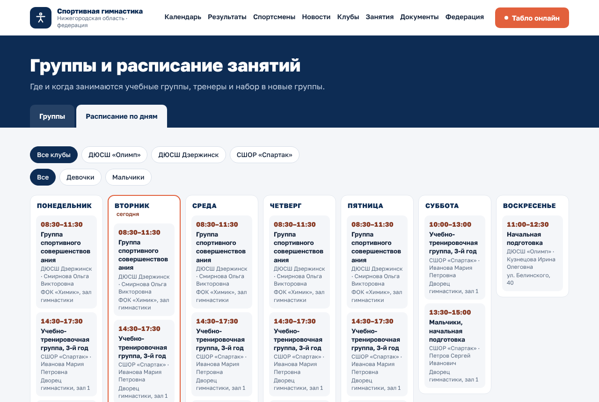
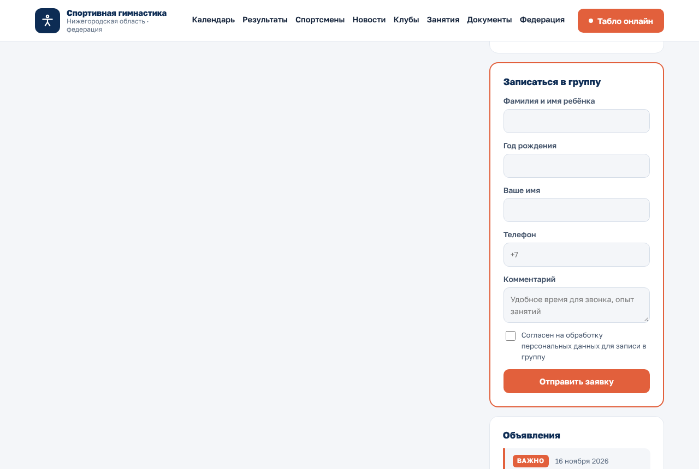
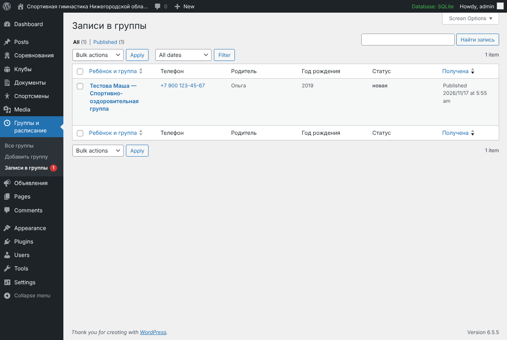
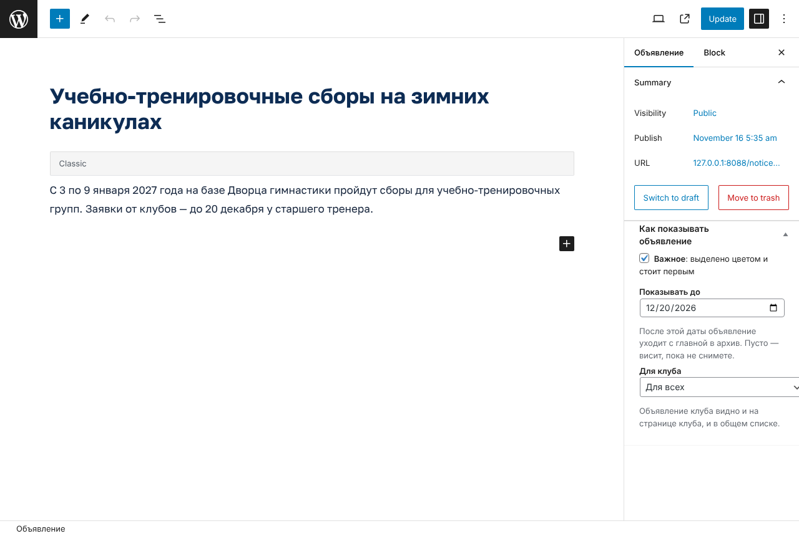

# Сайт федерации на теме «Спортивная гимнастика — федерация»: инструкция для администратора

Инструкция для того, кто ведёт сайт федерации на WordPress: как поставить тему, связать сайт с программой соревнований и что заполнять в админке. Табло, приём заявок, протоколы и итоги сайт берёт из программы сам, переносить результаты руками не нужно.

Эта же инструкция лежит в архиве темы файлом `Инструкция по сайту.pdf`.

## Содержание

1. [Установка темы](#1-установка-темы)
2. [Настройка сайта](#2-настройка-сайта)
3. [Связь с программой соревнований](#3-связь-с-программой-соревнований)
4. [Соревнования](#4-соревнования)
5. [Результаты, новость «Итоги» и рейтинг сезона](#5-результаты-новость-итоги-и-рейтинг-сезона)
6. [Фотографии турнира](#6-фотографии-турнира)
7. [Анонсы в Telegram и ВКонтакте](#7-анонсы-в-telegram-и-вконтакте)
8. [Календарь в телефоне](#8-календарь-в-телефоне)
9. [Клубы](#9-клубы)
10. [Учебные группы и расписание занятий](#10-учебные-группы-и-расписание-занятий)
11. [Запись в группу с сайта](#11-запись-в-группу-с-сайта)
12. [Объявления](#12-объявления)
13. [Новости и документы](#13-новости-и-документы)
14. [Меню](#14-меню)
15. [Обновление темы](#15-обновление-темы)
16. [Если что-то не работает](#16-если-что-то-не-работает)

---

## 1. Установка темы

1. Войдите в админку сайта (`https://ваш-сайт/wp-admin`).
2. Откройте **Внешний вид → Темы → Добавить новую тему → Загрузить тему**.
3. Выберите файл `ag-federation-theme.zip` и нажмите **Установить**, затем **Активировать**.
4. Откройте **Настройки → Постоянные ссылки**, выберите **Название записи** и нажмите **Сохранить**. Это нужно один раз, чтобы открывались разделы `/competitions/`, `/clubs/`, `/athletes/`, `/groups/`, `/notices/`.

Тема работает с WordPress 6.0 и новее и PHP 7.4 и новее. Плагин «Табло результатов» ей не нужен, но и не мешает.

## 2. Настройка сайта

Откройте **Внешний вид → Настроить**.

- **Сайт федерации**: название организации, адрес, телефон, почта, ссылки на ВКонтакте и Telegram, заголовок и текст первого экрана главной, текст и четыре цифры блока «О федерации», страницы «О федерации» и «Судейская коллегия».
- **Сайт федерации → Программа соревнований**: адрес ретранслятора результатов. Если ретранслятор распакован в папку `results` этого же сайта, поле оставьте пустым.
- **Цвета**: основной цвет и цвет акцента.
- **Свойства сайта**: логотип и значок сайта.

## 3. Связь с программой соревнований

Чтобы секретарь заводил турнир на сайте кнопкой из программы, нужен пароль приложения WordPress. Это не пароль от сайта: его можно отозвать в любой момент, и он не даёт войти в админку.

1. Войдите под пользователем с правами **редактора** или **администратора** и откройте **Пользователи → Профиль**.
2. Внизу, в блоке **Пароли приложений**, впишите название, например `Программа соревнований`, и нажмите **Добавить пароль приложения**.
3. Скопируйте показанный пароль (вида `abcd EFGH 1234 ijkl MNOP 5678`) и передайте его тому, кто ставит программу. Второй раз WordPress его не покажет.
4. В файле `.env` программы заполняются строки `WP_USER` (логин этого пользователя) и `WP_APP_PASSWORD` (пароль приложения). Подробно об этом написано в инструкции по установке программы, шаг 12.

Блока «Пароли приложений» нет, если сайт открывается по `http://`: WordPress принимает такие пароли только по `https://`. Включите на хостинге бесплатный сертификат Let’s Encrypt.

## 4. Соревнования

### Турнир заводит программа

В секретариате, на экране **Соревнование**, панель **Карточка на сайте федерации**: секретарь вписывает даты, место и город и нажимает **Подключить к сайту**. На сайте появляется карточка соревнования с названием, датами, местом, полом, разрядами, ID турнира и ключом онлайн-заявок. После изменения дат или срока заявок секретарь нажимает **Обновить на сайте**.

Название и текст, исправленные на сайте, программа не перезаписывает. Поэтому после подключения редактор сайта может спокойно:

- поправить название;
- вставить текст из положения;
- заполнить программу по дням;
- приложить файлы (положение, форма заявки);
- поставить картинку записи.

### Турнир можно завести и вручную

**Соревнования → Добавить соревнование**: название, текст, затем поля под текстом.

| Поле | Что вписать |
| --- | --- |
| Начало, Окончание | Даты турнира. Для однодневного старта окончание можно не заполнять |
| Место проведения, Город | Например, «Дворец гимнастики», «Нижний Новгород» |
| Кто выступает, Разряды и возраст | Девушки, юноши или все; «КМС, 1 разряд · 2012–2014 г.р.» |
| ID соревнования | Из секретариата, блок «Результаты на сайте». Можно вставить скопированный шорткод целиком, тема сама найдёт ID. У турнира девушек и юношей два ID |
| Ключ приёма заявок | Из секретариата, блок «Онлайн-заявки клубов». Можно вставить всю ссылку на форму или шорткод кнопки |
| Заявки до | Срок приёма заявок, если он не задан в секретариате |
| Стадия | Обычно не трогайте: страница сама переключается по датам |
| Программа по дням | Каждый день с новой строки: дата, вертикальная черта, что происходит |
| Документы соревнования | Файлы из медиатеки: положение, форма заявки |

### Что видят посетители

Страница турнира сама переключается по датам:

- **до старта** открыта вкладка «До старта · заявки»: кнопка «Подать заявку клуба» и срок приёма, программа, документы, стартовые протоколы;
- **в дни турнира** открыта вкладка «Табло онлайн», а главная начинается с блока «Идёт сейчас» с карточкой «На помосте» и табло;
- **после окончания** открыта вкладка «Итоги и протоколы»: призёры, протоколы, полная таблица многоборья, новости турнира.

Календарь (`/competitions/`) показывает ближайшие старты, архив по годам и фильтры: девушки, юноши, открытый приём заявок.

## 5. Результаты, новость «Итоги» и рейтинг сезона

После окончания турнира тема в течение часа сама забирает итоговые результаты из программы и сохраняет их на сайте. Для каждого участника появляется страница в разделе «Спортсмены»: клуб, медали, лучшие оценки по снарядам, все выступления. Результаты остаются на сайте, даже если ретранслятор очистят.

- Если оценку исправили после турнира, откройте карточку соревнования и справа нажмите **Сохранить результаты сейчас** (или **Обновить результаты**).
- Тёзки из разных клубов считаются разными людьми. Если спортсменка перешла в другой клуб и у неё две страницы, откройте одну из них в админке и в блоке «Это один и тот же человек?» выберите вторую: результаты объединятся.

### Черновик новости «Итоги»

Когда итоги турнира впервые сохранились на сайте, тема сама составляет черновик новости «Итоги: название турнира» в рубрике «Результаты». В нём:
- даты, место, сколько спортсменов и клубов выступало;
- призёры каждого многоборья и командного первенства;
- ссылки на протоколы и на страницу соревнования.

Черновик никто не видит, пока его не опубликуют. Ссылка на него появляется в карточке соревнования, в блоке «Результаты на сайте». Откройте черновик, при желании добавьте фото и пару слов и нажмите **Опубликовать**. Новость сама появится во вкладке «Итоги» на странице турнира. Если черновик удалили, кнопка **Составить новость об итогах** в том же блоке соберёт его заново.

### Рейтинг сезона

Страница **Рейтинг сезона** (`/rating/`, ссылки в подвале и на странице «Спортсмены») считается сама по сохранённым результатам. На ней:
- спортсмены года по медалям в многоборье и финалах отдельных видов;
- клубы по медалям своих спортсменов;
- переключатели года и девушек и юношей.

Порядок такой: сначала по золоту, затем по серебру, бронзе и числу стартов. Чтобы клуб считался один раз, впишите в его карточке все написания из протоколов (раздел 9).

## 6. Фотографии турнира

В карточке соревнования, блок **Фотографии турнира**: кнопка **Добавить фото** открывает медиатеку, где можно выбрать сразу много снимков. Порядок меняется перетаскиванием, лишний снимок убирает крестик. В поле **Ссылка на весь альбом** можно вставить альбом ВКонтакте или папку на Яндекс Диске.

На странице турнира, во вкладке «Итоги и протоколы», появляется блок «Фото». Снимок открывается на весь экран, листается стрелками или пальцем на телефоне. Подпись к фото берётся из поля «Подпись» в медиатеке.

## 7. Анонсы в Telegram и ВКонтакте

Тема может сама писать в канал федерации:
- **в день старта**: «Идёт сейчас: название турнира, табло онлайн: ссылка»;
- **после турнира**, когда сохранились итоги: «Итоги» с призёрами и ссылкой на протоколы.

Каждый анонс уходит один раз. Об итогах турниров, закончившихся больше трёх дней назад (например, сразу после установки темы), тема не пишет.

**Настройка** в разделе **Внешний вид → Настроить → Сайт федерации → Анонсы в соцсетях**.

Telegram:
1. В Telegram напишите @BotFather команду `/newbot` и получите токен бота.
2. Добавьте бота в канал администратором с правом публиковать сообщения.
3. Впишите токен и имя канала (`@имя_канала`).

ВКонтакте:
1. В сообществе откройте **Управление → Работа с API → Ключи доступа** и создайте ключ с правом «Стена».
2. Впишите ключ и номер группы (цифры из адреса `vk.com/club123456`).

Можно заполнить только одну соцсеть.

В карточке соревнования блок **Анонсы в соцсетях** показывает, что и когда отправлено. Если соцсеть не приняла пост, там написана причина. Кнопками **Отправить «Турнир начался»** и **Отправить «Итоги»** анонс можно отправить вручную, в том числе повторно.

## 8. Календарь в телефоне

На странице календаря соревнований под заголовком есть ссылки **подписаться** (календарь iPhone, Outlook) и **Google Календарь**. Подписавшийся видит все турниры федерации в своём календаре: новые появляются сами, изменения дат подтягиваются. Адрес подписки: `/competitions/calendar.ics`.

На странице турнира до старта есть ссылка **В календарь**: она скачивает файл одного соревнования.

## 9. Клубы

**Клубы → Добавить клуб**: название, текст о клубе, логотип (картинка записи), город, адрес, телефон, сайт, почта для записей в группы (на сайте не показывается), тренеры (каждый с новой строки).

Поле **Как называется клуб в протоколах**: перечислите через запятую написания из заявок, например `СШОР Спартак, СШОР «Спартак» Н.Новгород`. По ним на странице клуба собираются его спортсмены, медали и последние старты.

На странице клуба также видны его учебные группы с расписанием и объявления клуба. Порядок клубов в списке задаёт поле **Порядок** в блоке «Атрибуты».

## 10. Учебные группы и расписание занятий

**Группы и расписание → Добавить группу**.

| Поле | Что вписать |
| --- | --- |
| Название | Например, «Начальная подготовка, 1-й год» |
| Текст | Необязательно: чем занимается группа, что взять с собой |
| Клуб или школа | Выбирается из раздела «Клубы» |
| Тренер | ФИО тренера |
| Этап подготовки | Спортивно-оздоровительная, начальная подготовка, учебно-тренировочная, спортивное совершенствование, высшее мастерство |
| Кто занимается | Все, девочки или мальчики |
| Возраст | «2017–2018 г.р.» или «5–7 лет» |
| Где занимается | Зал и адрес |
| Период | Необязательно: «с 1 сентября по 31 мая» |
| Набор | Отметьте **Идёт набор в группу**: на сайте появится плашка, телефон клуба и форма записи, а группа попадёт на главную в блок «Набор в группы» |

**Расписание занятий** заполняется таблицей: день недели, начало, конец и, если занятие проходит не там, где обычно, место. Кнопка **+ Добавить занятие** добавляет строку с тем же временем через день (Пн → Ср → Пт): обычно остаётся поменять только день. Лишнюю строку убирает ссылка «убрать».

**Состав группы**: каждый спортсмен с новой строки, можно с годом рождения. Список виден на сайте всем, поэтому публикуйте его с согласия родителей. Если поле пустое, состав на странице не показывается.

На сайте раздел **Группы и расписание** (`/groups/`):

- вкладка **Группы**: карточки групп по клубам с днями и временем занятий;
- вкладка **Расписание по дням**: сетка на неделю из расписаний всех групп, сегодняшний день выделен;
- фильтры по клубу и по девочкам и мальчикам;
- у каждой группы своя страница: расписание, состав, тренер, телефон клуба и его объявления.

Порядок групп внутри клуба задаёт поле **Порядок** в блоке «Атрибуты».

## 11. Запись в группу с сайта

На странице группы с отметкой **Идёт набор** есть форма **Записаться в группу**. Родитель указывает фамилию и имя ребёнка, год рождения, своё имя, телефон и комментарий и соглашается на обработку персональных данных. В карточках групп рядом появляется кнопка **Записаться онлайн**.

Куда приходят заявки:
- в админку, раздел **Группы и расписание → Записи в группы**. Рядом с пунктом меню стоит число новых записей;
- письмом на почту клуба (поле **Почта для записей в группы** в карточке клуба). Если её нет — на почту федерации из настроек темы, а если нет и её — на почту администратора сайта.

Когда родителю перезвонили, наведите на запись и нажмите **Обработана** или поставьте отметку в самой записи.

Чтобы письма доходили, на хостинге должна работать отправка почты. Если писем нет, поставьте плагин отправки через SMTP (например, WP Mail SMTP); записи в админке сохраняются в любом случае.

От роботов форма защищена скрытым полем и проверкой времени заполнения. С одного адреса принимается не больше пяти заявок в час.

## 12. Объявления

**Объявления → Добавить объявление**: заголовок и текст. Справа, в блоке «Как показывать объявление»:

- **Важное**: объявление выделено цветом, помечено «Важно» и стоит первым;
- **Показывать до**: после этой даты объявление уходит с главной в «Прошедшие». Пусто — висит, пока его не снимут;
- **Для клуба**: объявление видно ещё и на странице клуба и его групп. «Для всех» — общее объявление федерации.

Три свежих объявления (важные первыми) показываются на главной, все — в разделе **Объявления** (`/notices/`).

## 13. Новости и документы

**Новости** — обычные записи WordPress с рубриками и картинкой. В боковой панели записи можно выбрать соревнование: новость появится во вкладке «Итоги» на его странице.

**Документы → Добавить документ**: название, файл из медиатеки или ссылка на файл, раздел («Положения», «Правила», «Календарь и нормативы»). Ссылка на документ ведёт сразу на файл.

## 14. Меню

Пока меню не собрано, тема показывает стандартное: Календарь, Результаты, Спортсмены, Новости, Клубы, Занятия, Документы, Федерация. Пункт «Занятия» появляется сам, как только добавлена первая группа. В подвале сами появляются «Рейтинг сезона», «Календарь в телефон», «Расписание занятий» и «Объявления».

Своё меню собирается в **Внешний вид → Меню**: области «Главное меню» и «Меню в подвале». Нужные разделы добавляются через «Произвольные ссылки»: `/competitions/`, `/athletes/`, `/rating/`, `/clubs/`, `/groups/`, `/groups/?view=week`, `/notices/`, `/documents/`.

## 15. Обновление темы

Загрузите новый `ag-federation-theme.zip` тем же способом (**Внешний вид → Темы → Добавить новую тему → Загрузить тему**). WordPress предложит **Заменить текущую версию загруженной**: согласитесь. Записи, настройки и сохранённые результаты не пропадут, новые разделы откроются сами.

## 16. Если что-то не работает

| Что случилось | Что сделать |
| --- | --- |
| Раздел `/groups/` или `/athletes/` открывается с ошибкой 404 | «Настройки → Постоянные ссылки» → «Сохранить» |
| На странице турнира нет табло | Проверьте поле «ID соревнования» и адрес ретранслятора в настройках темы |
| Нет кнопки «Подать заявку» | В карточке пустой «Ключ приёма заявок» или приём не открыт в секретариате |
| Программа пишет «Сайт не принял пароль приложения» | Проверьте `WP_USER` (логин, не e-mail) и `WP_APP_PASSWORD` в `.env`; сайт должен открываться по https |
| Программа пишет «На сайте не включена тема…» | Активируйте эту тему или обновите её до последней версии |
| У спортсменки две страницы | Объедините их в админке, блок «Это один и тот же человек?» |
| После турнира нет итогов | Подождите час или нажмите «Сохранить результаты сейчас» в карточке соревнования |
| Объявление пропало с главной | У него прошла дата «Показывать до»; оно в разделе «Объявления», в «Прошедших» |
| Анонс не ушёл в Telegram | Бот не администратор канала или неверное имя канала; причина — в блоке «Анонсы в соцсетях» карточки |
| Анонс не ушёл во ВКонтакте | У ключа нет права «Стена» или неверный номер группы; причина — там же |
| Не приходят письма о записях в группы | Записи есть в админке. Для писем поставьте плагин отправки почты через SMTP |
| Нет черновика «Итоги» | Он появляется после сохранения результатов; кнопка «Составить новость об итогах» в блоке «Результаты на сайте» |
| В рейтинге клуб записан дважды | Добавьте второе написание в поле «Как называется клуб в протоколах» |
| `/rating/` или `calendar.ics` открывается с ошибкой 404 | «Настройки → Постоянные ссылки» → «Сохранить» |
